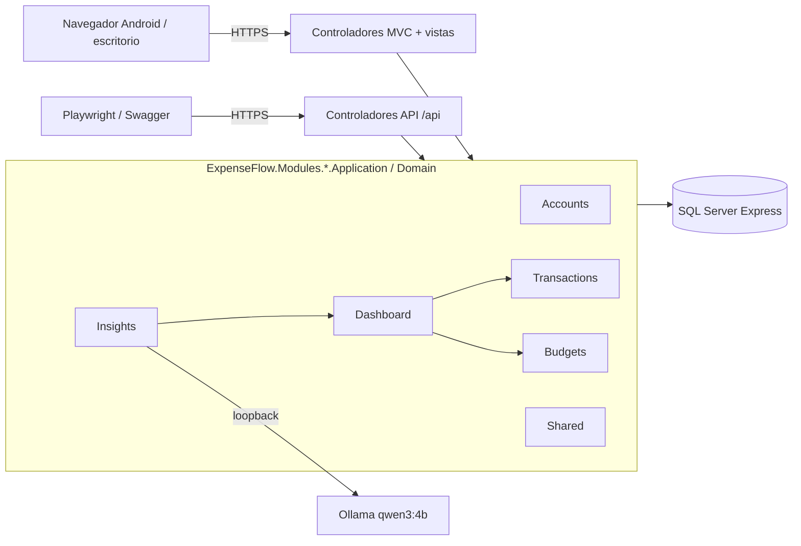
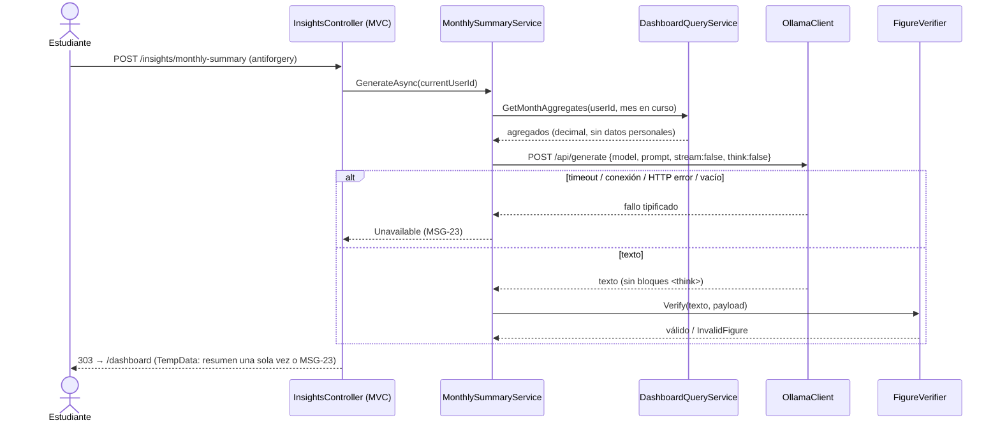
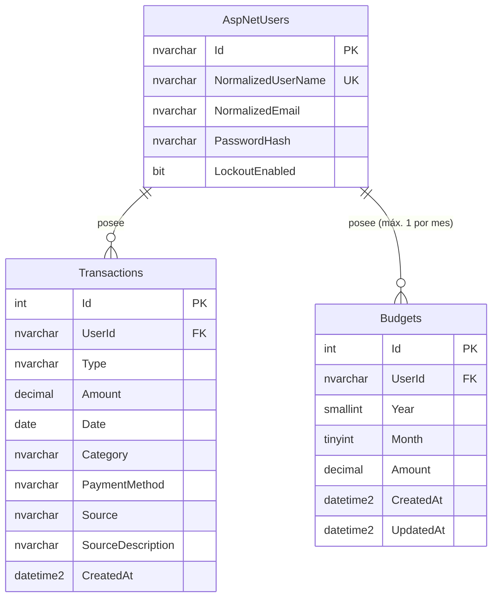

# 07 — Arquitectura inicial — ExpenseFlow AI

| Campo | Valor |
|---|---|
| Documento | 07-architecture.md |
| Fase | Solución (BMAD — Agente Architect) |
| Versión | v1.0 |
| Fecha | 2026-11-10 |
| Estado | **Aprobado** |
| Aprobado por | Piero Carbajal |
| Fecha de aprobación | 2026-11-10 |
| PR de aprobación | PR que fusiona el Spec Pack v1.0 en `main` (ADR-005 §1) |
| Insumos | `00-constitucion.md` a `06-user-stories.md` v1.0, `09-ui-spec.md` v1.0, ADR-001 a ADR-007 v1.0 |

> **Convenciones**
> - **[Decisión]**: tomada en un documento aprobado (decisiones DEC-NN de `03` §9 o un ADR); aquí solo se materializa.
> - Si este documento y `03` o un ADR difieren, **prevalecen `03` y el ADR**, y este documento se corrige en un PR.
> - Identificadores propios: componentes ARQ-01 a ARQ-09 (§2.2), principios de diseño DP-1 a DP-9 (§1.3), notas de seguridad NS-1 a NS-8 (§3.3), restricciones RC-1 a RC-8 (§6.2) y riesgos RA-01 a RA-05 (§7.1).
> - Los mensajes se citan por su ID (`MSG-NN`); el texto exacto está en `03` §10.
> - Importes en la UI: formato RN-081 (`S/ 1,250.50`). En JSON: número.
> - Los `id` de los ejemplos son ilustrativos: las pruebas obtienen los identificadores consultando la base, no los fijan.

---

## 1. Overview del sistema

### 1.1 Descripción

ExpenseFlow AI es un **monolito modular ASP.NET Core** que expone la misma lógica de negocio por dos fachadas: **vistas Razor (MVC)** renderizadas en el servidor, que usa el estudiante desde el navegador de su Android o su computadora, y una **API REST** documentada en OpenAPI, que permite probar y automatizar cada caso de uso. Toda cifra financiera (saldos, totales, porcentaje de consumo, umbrales) la calcula de forma determinista la capa `Application` y `Domain` de cada módulo, con `decimal` y un único modo de redondeo; las vistas y el navegador solo la muestran. La persistencia es **SQL Server Express** mediante EF Core, con aislamiento por `UserId` obtenido siempre del contexto de autenticación. La IA es un componente **periférico y degradable**: Ollama local (`qwen3:4b`) recibe solo agregados ya calculados, redacta un resumen en español y `FigureVerifier` descarta cualquier texto con cifras que no estén en esos datos.

### 1.2 Diagrama de arquitectura (textual)

```
                 ┌───────────────────────────────────────────────────────────┐
  Navegador      │          src/ExpenseFlow (un proyecto, host único)        │
  Android /      │                                                           │
  escritorio     │  Pipeline: exception handler (≠Dev) → HSTS (≠Dev) →       │
  (HTML + JS     │  HTTPS redirect → archivos estáticos (wwwroot/lib) →      │
   mínimo)       │  routing → autenticación (cookie Identity) →              │
      │          │  autorización → endpoints                                 │
      │ HTTPS    │  Filtros globales MVC: autorización, antiforgery          │
      ├─────────►│                                                           │
      │ (MVC)    │  Modules/<Módulo>/Web: controladores MVC y API, vistas    │
  Playwright /   │                        │                                  │
  Swagger (Dev) ►│                        ▼                                  │
  (HTTPS, API)   │  Modules/<Módulo>/Application → Domain                    │
                 │   ┌──────────┐ ┌────────────┐ ┌─────────┐ ┌───────────┐   │
                 │   │ Accounts │ │Transactions│ │ Budgets │ │ Dashboard │   │
                 │   └──────────┘ └────────────┘ └─────────┘ └─────┬─────┘   │
                 │   ┌──────────────────────────────┐   agregados  ▼         │
                 │   │ Insights (IA, degradable)    │◄──────────────┘        │
                 │   │ PayloadBuilder → OllamaClient│                        │
                 │   │ → FigureVerifier             │                        │
                 │   └───────────────┬──────────────┘                        │
                 │   Shared: MoneyRounding, MoneyFormat, MoneyParser,        │
                 │   LimaClock, ICurrentUser, Messages, ExpenseFlowDbContext │
                 └──────────────┬──────────────────────────────┬─────────────┘
                                │ TDS (local)                  │ HTTP loopback
                                ▼                              ▼
                     ┌─────────────────────┐       ┌──────────────────────────┐
                     │ SQL Server Express  │       │ Ollama + qwen3:4b        │
                     │ (Docker solo en CI) │       │ localhost / 127.0.0.1 /  │
                     └─────────────────────┘       │ ::1 (ADR-002)            │
                                                   │ En CI: cliente simulado  │
                                                   └──────────────────────────┘
```



**Flujo del resumen de IA (HU-010A/B, RN-165, RN-166):**



### 1.3 Principios de diseño

| # | Principio | De dónde sale | Cómo se aplica |
|---|---|---|---|
| DP-1 | **El backend es la única fuente de cifras** | PRINCIPIO-004, RN-027 | Las vistas reciben `ViewModel` con importes ya calculados y formateados por `MoneyFormat`. El JS nunca suma ni calcula (HU-008: dashboard idéntico con JS deshabilitado). |
| DP-2 | **Una lógica, dos fachadas** | PRINCIPIO-002, PRINCIPIO-012, ADR-004 §1 | MVC y API llaman a los mismos servicios de `Application`. Ninguna regla vive en un controlador. |
| DP-3 | **Aislamiento por construcción** | PRINCIPIO-007 | `ICurrentUser.UserId` sale del `ClaimsPrincipal`; los repositorios exigen `userId`; los DTO de entrada no tienen `userId`. Recurso ajeno ⇒ `404`, evaluado **antes** que la validación del cuerpo (ADR-004 §3.1, DEC-58). |
| DP-4 | **Servidor primero, JavaScript mínimo** | Contexto: Android gama baja, red intermitente; ADR-006 | Páginas Razor completas, Post/Redirect/Get, formularios con `novalidate`. El JS solo mejora: deshabilitar el botón al enviar (RN-131, RN-168), mostrar «Descripción» con «Otros», diálogo de eliminación. |
| DP-5 | **IA periférica y degradable** | PRINCIPIO-004, PRINCIPIO-005, RN-085 | Insights no es dependencia de ningún otro módulo. Si falla, M1–M5 siguen funcionando y se muestra MSG-23 o MSG-24. |
| DP-6 | **Tiempo inyectable** | RN-137 | Todo «hoy» y «ahora» sale de `TimeProvider` (`LimaClock` para la zona `America/Lima`). Una prueba de arquitectura busca en el código fuente las API de fecha prohibidas. |
| DP-7 | **Dinero como tipo de primera clase** | PRINCIPIO-003 | `decimal`, `DECIMAL(18,2)`, `MoneyRounding.Mode = MidpointRounding.AwayFromZero` en una sola constante. |
| DP-8 | **Módulos con fronteras explícitas** | PRINCIPIO-011, ADR-004 §2 | Cada módulo tiene `Domain`, `Application`, `Infrastructure`, `Web` y su `README.md`; un módulo solo usa los servicios públicos de `Application` de otro, nunca sus entidades. Se verifica con una prueba de arquitectura. |
| DP-9 | **Errores en español y sin detalles técnicos** | PRINCIPIO-001, RN-116, RN-164 | `ValidationProblemDetails` con `title` = MSG-44 y textos de `03` §10; `ProblemDetails` con `code` (`MSG-NN`) en errores de negocio; página de error en español en MVC (salvo `Development`). Solo `401`, `404` y el `400` de antiforgery usan el `ProblemDetails` estándar (ADR-004 §3.1). |

---

## 2. Componentes principales

### 2.1 Estructura de la solución [Decisión: ADR-004 §2, DEC-62]

```
src/ExpenseFlow/                              # Un proyecto ASP.NET Core (host único)
  ExpenseFlow.csproj                          # InvariantGlobalization = false (ADR-004 §6)
  Program.cs
  wwwroot/lib/                                # Bootstrap 5 local (sin CDN)
  Modules/
    Shared/
      Domain/          MoneyRounding, MoneyFormat, MoneyParser
      Application/     LimaClock, ICurrentUser, Messages (catálogo MSG-NN)
      Infrastructure/  Persistence/ExpenseFlowDbContext, Migrations/, Seed/DemoSeeder
      Web/             Layout, vista de error, filtros, scripts de mejora progresiva
      README.md
    Accounts/      {Domain, Application, Infrastructure, Web, README.md}
    Transactions/  {Domain, Application, Infrastructure, Web, README.md}
    Budgets/       {Domain, Application, Infrastructure, Web, README.md}
    Dashboard/     {Domain, Application, Infrastructure, Web, README.md}
    Insights/      {Domain, Application, Infrastructure, Web, Prompts/monthly-summary.v1.md, README.md}
tests/
  ExpenseFlow.UnitTests/          # xUnit, [Trait("Rule","RN-NNN")]
  ExpenseFlow.IntegrationTests/   # xUnit + WebApplicationFactory + FakeTimeProvider + SQL Server
  ExpenseFlow.ArchitectureTests/  # análisis del código fuente: fronteras, API prohibidas
  ExpenseFlow.E2ETests/           # Playwright + axe (F-01 a F-07)
  ExpenseFlow.AiEvals/            # consola: 10 escenarios con Ollama real (ADR-003 §2)
.config/dotnet-tools.json         # dotnet-ef en la versión de EF Core (ADR-001)
global.json                       # .NET 10
Directory.Packages.props          # solo paquetes de ADR-001
```

- Los namespaces siguen la carpeta: `ExpenseFlow.Modules.<Módulo>.<Capa>`. Así, `MoneyFormat`, `MoneyParser`, `MoneyRounding`, `LimaClock` y el catálogo de mensajes quedan dentro del filtro de cobertura de ADR-001 (`ExpenseFlow.Modules.*.Domain|Application`).
- Las vistas viven en `Modules/<Módulo>/Web/Views/`. Se registran con `RazorViewEngineOptions.ViewLocationFormats` (`/Modules/{2}/Web/Views/{1}/{0}.cshtml`, con el área como módulo) y la vista compartida en `Modules/Shared/Web/Views/Shared/`.
- Las configuraciones de EF Core de cada entidad (`IEntityTypeConfiguration<T>`) viven en el `Infrastructure` de su módulo; `ExpenseFlowDbContext` las aplica con `ApplyConfigurationsFromAssembly`.
- La ruta de instrucciones del modelo es `src/ExpenseFlow/Modules/Insights/Prompts/monthly-summary.v1.md` (RN-129).

### 2.2 Catálogo de componentes

| # | Componente | Ubicación | Responsabilidad | Tecnología | HU |
|---|---|---|---|---|---|
| ARQ-01 | **Web Host** | `Program.cs`, `Modules/Shared/Web` | Composición (DI), pipeline HTTP, HTTPS/HSTS/TLS, cookie, filtros globales de autorización y antiforgery, manejo global de errores, Swagger (solo `Development`), layout accesible | ASP.NET Core MVC, Razor Views, Bootstrap 5 local, OpenAPI | HU-002B, HU-011, HU-013 |
| ARQ-02 | **Accounts** | `Modules/Accounts` | Registro con mayoría de edad, validación de correo (orden RN-149), inicio de sesión con bloqueo, cierre de sesión, `returnUrl` local; sin páginas de gestión de cuenta | ASP.NET Core Identity + EF Core (sin `Identity.UI`) | HU-001, HU-002A, HU-002B |
| ARQ-03 | **Transactions** | `Modules/Transactions` | Alta, edición (`PUT` completo), eliminación física y lista paginada; medio de pago preseleccionado | C#, EF Core | HU-003 a HU-006, HU-011 |
| ARQ-04 | **Budgets** | `Modules/Budgets` | Presupuesto del mes en curso: crear, editar, consultar; unicidad por mes; sin eliminación | C#, EF Core | HU-007, HU-011 |
| ARQ-05 | **Dashboard** | `Modules/Dashboard` | Cálculos deterministas (`DashboardCalculator`) y consulta (`DashboardQueryService`) | C# (`decimal`), EF Core de solo lectura | HU-008, HU-009 |
| ARQ-06 | **Insights** | `Modules/Insights` | `PayloadBuilder`, `OllamaClient` (30 s, sin reintentos), `AiOptionsValidator`, `FigureVerifier`, resumen de un solo uso | `HttpClient` (sin NuGet), Ollama `qwen3:4b` | HU-010A, HU-010B |
| ARQ-07 | **Shared** | `Modules/Shared/Domain`, `Application` | `MoneyRounding`, `MoneyFormat`, `MoneyParser`, `LimaClock`, `ICurrentUser`, catálogo `Messages` | C# | HU-003, HU-008, HU-011 |
| ARQ-08 | **Persistencia y seed** | `Modules/Shared/Infrastructure` | `ExpenseFlowDbContext`, migraciones aditivas, `DemoSeeder` idempotente | EF Core, SQL Server Express | HU-014 |
| ARQ-09 | **Suite de calidad** | `tests/*`, `.github/workflows` | Unitarias, integración, arquitectura, E2E con axe, evaluaciones de IA, verificación de `Trait` | xUnit, Mvc.Testing, TimeProvider.Testing, coverlet, Playwright, axe, `pwsh` (ADR-001) | Todas (PRINCIPIO-011) |

### 2.3 Detalle por componente

**ARQ-01 — Web Host**

- Pipeline: `UseExceptionHandler("/Error")` (≠ `Development`) → `UseHsts()` (≠ `Development`) → `UseHttpsRedirection()` → `UseStaticFiles()` → `UseRouting()` → `UseAuthentication()` → `UseAuthorization()` → `MapControllers()` / `MapControllerRoute()`.
- HSTS: `AddHsts(o => o.ExcludedHosts.Clear())`. Por defecto ASP.NET Core excluye `localhost`, `127.0.0.1` y `[::1]`, lo que impediría verificar RN-100 en `Testing`.
- Kestrel: `SslProtocols = Tls12 | Tls13` (RN-156).
- **Sin compresión de respuestas**: todo el tráfico es HTTPS (PRINCIPIO-008) y comprimir páginas con tokens antiforgery las expone a BREACH. Los estáticos se sirven minificados con `asp-append-version` y caché larga.
- Filtros globales de MVC (`AddControllersWithViews`):
  - política de autorización por defecto (todo requiere sesión salvo `[AllowAnonymous]`: registro, inicio de sesión, `POST /account/logout` (RN-177), las páginas de error y `GET /api/antiforgery/token`);
  - `AutoValidateAntiforgeryTokenAttribute`, que valida `POST`, `PUT` y `DELETE` en controladores MVC **y** API (RN-101). `AddAntiforgery(o => o.HeaderName = "X-CSRF-TOKEN")`. El middleware `UseAntiforgery()` no se usa: solo actúa sobre endpoints con metadatos de antiforgery y no protege controladores.
  - El filtro de autorización se ejecuta antes que el de antiforgery: sin sesión ⇒ `401` aunque falte el token (RN-101).
- `ApiBehaviorOptions.SuppressModelStateInvalidFilter = true` en los controladores API: el controlador comprueba primero la pertenencia (`404`) y después devuelve el `400` de validación (ADR-004 §3.1, DEC-58).
- Cookie de autenticación: `HttpOnly`, `Secure`, `SameSite=Lax`, no persistente (`isPersistent: false`, RN-147), `ExpireTimeSpan = 60 min`, `SlidingExpiration = true` (RN-098). Para `/api/*`, `OnRedirectToLogin` ⇒ `401` con el `ProblemDetails` estándar en el cuerpo (RN-102, DEC-88) y `OnRedirectToAccessDenied` ⇒ `403`.
- Cookie de marca `ef_session` (`HttpOnly`, `Secure`, `SameSite=Lax`, de sesión, sin datos): se emite al iniciar sesión y se elimina al cerrarla. Si una solicitud MVC llega con la marca y sin cookie de autenticación válida, `OnRedirectToLogin` agrega `reason=expired` a la redirección y elimina la marca: P-002 muestra MSG-48 (RN-171).
- Rechazo antiforgery en MVC: un filtro de resultado convierte el `400` de `AutoValidateAntiforgeryTokenAttribute` en la página P-016 con MSG-46 (RN-170). En la API se mantiene el `ProblemDetails` estándar.
- `UseStatusCodePagesWithReExecute("/Error/{0}")` muestra P-012 para los `404` de MVC (RN-169).
- `Cache-Control: no-store` en toda respuesta autenticada (RN-140).
- Swagger UI solo en `Development` (ADR-001, ADR-004 §4).

**ARQ-02 — Accounts**

- Registro de Identity sin `Identity.UI` (RN-145):

  ```csharp
  builder.Services
      .AddIdentityCore<ApplicationUser>(o => { /* opciones de la tabla siguiente */ })
      .AddSignInManager()
      .AddEntityFrameworkStores<ExpenseFlowDbContext>()
      .AddDefaultTokenProviders();
  builder.Services
      .AddAuthentication(IdentityConstants.ApplicationScheme)
      .AddIdentityCookies();
  ```

  `GET /Identity/Account/Manage` y `/Identity/Account/ForgotPassword` no existen ⇒ `404`.
- Opciones (de `03`):

  | Opción | Valor | Regla |
  |---|---|---|
  | `Password.RequiredLength` / `RequireUppercase` / `RequireLowercase` / `RequireDigit` / `RequireNonAlphanumeric` | 8 / `true` / `true` / `true` / `true` | RN-094 |
  | `Lockout.MaxFailedAccessAttempts` / `DefaultLockoutTimeSpan` / `AllowedForNewUsers` | 5 / 5 min / `true` | RN-048, RN-004 |
  | `User.RequireUniqueEmail` | `true` | RN-095 |
  | `SignIn.RequireConfirmedAccount` | `false` | RN-096 |

- `UserName` = correo sin espacios exteriores. Así el índice único `UserNameIndex` de Identity garantiza en la base la unicidad del correo, también en registros simultáneos (RN-095, ADR-007). El índice `EmailIndex` de Identity no es único.
- Identity se registra con el `TimeProvider` de la aplicación (RN-137). Riesgo RA-05: se verifica en T-013 (`05` PQ-09).
- `PasswordSignInAsync(userName, password, isPersistent: false, lockoutOnFailure: true)` (RN-144, RN-147).
- Validador de registro propio, antes de Identity: correo sin espacios exteriores → vacío (MSG-32) → longitud > 256 (MSG-37) → formato RN-150 (MSG-33) → duplicado (MSG-04); contraseña (MSG-34, MSG-03); confirmación (MSG-36, MSG-35); casilla (MSG-01).
- Un único MSG-02 para contraseña incorrecta, correo inexistente y cuenta bloqueada (RN-050). Campos vacíos en el inicio de sesión ⇒ MSG-32 / MSG-34 sin llamar a `PasswordSignInAsync` (RN-154).
- `returnUrl`: `Url.IsLocalUrl` + `LocalRedirect` (rechaza `//host`), si no `/dashboard` (RN-155). Viaja en un campo oculto y se conserva tras cada error (DEC-72). Si apunta a una ruta que solo admite `POST`, se redirige a la página del formulario: `/insights/monthly-summary` ⇒ `/dashboard`; `/transactions/{id}/delete` ⇒ `/transactions` (RN-174).
- Un usuario autenticado que pide `/account/register` o `/account/login` va a `/dashboard` (RN-173).
- El correo del inicio de sesión se compara sin espacios exteriores (DEC-82).
- Rutas: `GET/POST /account/register`, `GET/POST /account/login` (con `returnUrl`) y `POST /account/logout` (DEC-63). La cookie de autenticación usa `LoginPath = /account/login`.
- Logs: solo `UserId`; nunca contraseña ni correo (RN-006).
- **No se guarda** una fecha de declaración de mayoría de edad: la casilla es obligatoria (RN-001) y ninguna regla exige conservar evidencia. `AdultDeclaration` es solo un campo del formulario.

**ARQ-03 — Transactions**

- Entidad `Transaction` con fábricas por tipo (`Expense`, `Income`) que imponen: categoría y medio solo en gastos; origen solo en ingresos; descripción solo con `Other`; cambiar el origen desde `Other` deja `SourceDescription = null` (RN-110).
- Formularios: `MoneyParser` sobre el texto (RN-104: acepta `3,50` y `3.50`; orden de validación de RN-104). API: número JSON (RN-053); texto ⇒ MSG-39.
- Fecha `DateOnly`: ≤ hoy de Lima (RN-057, MSG-10) y ≥ primer día del mes que está 11 meses antes del mes en curso (RN-109, MSG-17).
- Formulario MVC de ingreso: si llega `SourceDescription` con un origen distinto de `Other`, se descarta y se guarda `null`, sin error (DEC-66, nota de RN-110). La API no cambia: responde `400` con MSG-26.
- Lista: orden `Date DESC, CreatedAt DESC, Id DESC` (RN-079), `TransactionListPageSize = 20` (RN-117).
- Medio preseleccionado: último gasto por `CreatedAt DESC, Id DESC` (RN-018); `Cash` si no hay gastos (RN-108).

**ARQ-04 — Budgets**

- Solo el mes en curso de Lima (RN-022, RN-118). El campo oculto `month` del formulario solo se compara con el mes en curso (RN-167, MSG-22).
- Unicidad por índice único; la colisión se traduce a `409` + MSG-21 (ADR-007).
- `GET /budgets/create` con presupuesto del mes ⇒ `/budgets/edit` (RN-175); `GET /budgets/edit` sin presupuesto ⇒ `/budgets/create` (RN-176). Tras MSG-22, el formulario se presenta con el mes en curso y conserva el monto (DEC-84).

**ARQ-05 — Dashboard**

- `DashboardCalculator` puro (sin E/S), en `Dashboard.Domain`. Fórmulas de `03`:
  - total de gastos del mes (RN-023), porcentaje consumido (RN-024) redondeado con `MoneyRounding.Mode` (RN-025);
  - restante del presupuesto = presupuesto − gastos (RN-026), presentado con mínimo 0.00 (RN-071); exceso = |presupuesto − gastos| solo si gastos > presupuesto (RN-073);
  - saldo del mes (RN-074) y saldo acumulado (RN-075);
  - sin presupuesto: porcentaje `null`, sin avisos ni restante (RN-066, RN-121, RN-122);
  - `alert`: `Threshold80` si el porcentaje redondeado ∈ [80.00, 100.00), `Threshold100` si ≥ 100.00, `null` en otro caso (RN-028, RN-029, RN-120);
  - `budgetStatus`: `NotConfigured`, `Exceeded` (gastos > presupuesto, comparando importes) o `Normal` (RN-072, RN-120);
  - totales por categoría > 0, de mayor a menor, empate por el orden de RN-014 (RN-033).
- `DashboardQueryService` (en `Application`) obtiene los datos filtrando por `userId` y expone `GetMonthAggregates` para Insights.

**ARQ-06 — Insights**

- `AiOptionsValidator` al arrancar (ADR-002): URL absoluta `http`/`https`; host comparado por tipo (`UriHostNameType.Dns` ⇒ `localhost` sin distinguir mayúsculas; IP ⇒ `IPAddress.Equals` con `127.0.0.1` o `::1`); `Ai:Model` no vacío; `Ai:TimeoutSeconds` fuera de 5–120 ⇒ 30 con advertencia (RN-134). Si no cumple: IA deshabilitada, botón deshabilitado + MSG-24 (RN-132), la aplicación arranca igual (RN-085).
- `OllamaClient` con `IHttpClientFactory`: `Timeout` = `Ai:TimeoutSeconds`, sin política de reintentos (RN-083). Solicitud según ADR-003 §1 (sección 4.8). Elimina bloques `<think>…</think>`; texto vacío ⇒ `EmptyResponse`.
- `FigureVerifier` en `Insights.Domain` (ADR-003 §3; lo usan el producto y `ExpenseFlow.AiEvals`):
  1. Detección: secuencia de dígitos precedida por «S/», seguida por «%» o con parte decimal. Un entero sin «S/», «%» ni decimales no es cifra («2026», «3 categorías»).
  2. Normalización: coma seguida de exactamente 3 dígitos y de más dígitos o del final ⇒ miles; otra coma ⇒ decimal.
  3. Válida si su valor con 2 decimales es igual al **valor absoluto** de algún número del payload, o es un valor permitido: `80` y `100` seguidos de «%»; `0` con «S/» o «%».
  4. Una cifra no válida ⇒ `InvalidFigure` ⇒ MSG-23 (RN-166).
- Log de incidentes (RN-133): fecha y hora UTC, `type` (`Connection`, `Timeout`, `HttpError`, `EmptyResponse`, `InvalidFigure`), `status` si lo hubo, duración en ms y modelo. Nunca prompt, importes ni identificadores.
- Resumen MVC con PRG y TempData (proveedor de cookie cifrado con Data Protection), mostrado una sola vez y codificado por Razor (RN-128, RN-165; ADR-004 §1).

---

## 3. Modelo de datos

### 3.1 Entidades

> Identificadores en inglés (PRINCIPIO-001). No existe columna de moneda (PRINCIPIO-003, RN-012). Las fechas de creación y actualización se guardan en UTC como `datetime2`; las asigna la aplicación con `TimeProvider`, sin valores por defecto en SQL (RN-017, RN-137).

**`AspNetUsers`** (Identity, `ApplicationUser : IdentityUser`, sin columnas adicionales)

| Atributo | Tipo | Notas |
|---|---|---|
| `Id` | `nvarchar(450)` PK | GUID de Identity |
| `UserName`, `NormalizedUserName` | `nvarchar(256)` | `UserName` = correo; `NormalizedUserName` con índice único (`UserNameIndex`) |
| `Email`, `NormalizedEmail` | `nvarchar(256)` | RN-151 |
| `PasswordHash` | `nvarchar(max)` | `PasswordHasher` por defecto (RN-003) |
| `LockoutEnabled`, `LockoutEnd`, `AccessFailedCount` | Identity | `LockoutEnabled = 1` en toda cuenta nueva (RN-004) |

**`Transactions`**

| Atributo | Tipo | Notas |
|---|---|---|
| `Id` | `int IDENTITY` PK | Desempate de orden |
| `UserId` | `nvarchar(450)` FK → `AspNetUsers.Id` | `ON DELETE NO ACTION` (W19) |
| `Type` | `nvarchar(10)` | `Expense` \| `Income` (CHECK) |
| `Amount` | `decimal(18,2)` | CHECK `Amount BETWEEN 0.01 AND 100000.00` |
| `Date` | `date` | Fecha del movimiento (hora de Lima) |
| `Category` | `nvarchar(20)` NULL | Obligatoria si `Expense`, NULL si `Income` (CHECK) |
| `PaymentMethod` | `nvarchar(20)` NULL | Obligatorio si `Expense`, NULL si `Income` (CHECK) |
| `Source` | `nvarchar(20)` NULL | Obligatorio si `Income`, NULL si `Expense` (CHECK) |
| `SourceDescription` | `nvarchar(100)` NULL | Solo con `Source = 'Other'` (CHECK) |
| `CreatedAt` | `datetime2` | UTC; no editable |

Índices: `IX_Transactions_UserId_Date` `(UserId, Date DESC, CreatedAt DESC, Id DESC)`; `IX_Transactions_UserId_Type_CreatedAt` `(UserId, Type, CreatedAt DESC, Id DESC)`.

**`Budgets`**

| Atributo | Tipo | Notas |
|---|---|---|
| `Id` | `int IDENTITY` PK | Se conserva al editar (RN-065) |
| `UserId` | `nvarchar(450)` FK | `ON DELETE NO ACTION` |
| `Year` | `smallint` | |
| `Month` | `tinyint` | CHECK 1–12 |
| `Amount` | `decimal(18,2)` | CHECK `BETWEEN 0.01 AND 100000.00` |
| `CreatedAt`, `UpdatedAt` | `datetime2` | UTC |

Índice: `UX_Budgets_UserId_Year_Month` **UNIQUE** `(UserId, Year, Month)` (RN-064).

**Enumeraciones** (texto con `HasConversion<string>()`; códigos de ADR-004 §3.1)

| Enum | Valores |
|---|---|
| `TransactionType` | `Expense`, `Income` |
| `ExpenseCategory` | `Food`, `Transport`, `Studies`, `Entertainment`, `Health`, `Other` (orden de RN-014, usado en el desempate de RN-033) |
| `PaymentMethod` | `Cash`, `Yape`, `Plin`, `Card`, `Other` |
| `IncomeSource` | `FamilySupport`, `Job`, `Internship`, `Freelance`, `Other` |

Los nombres en español para la UI y para `totalsByCategory` del payload de IA (RN-034) salen de una tabla de traducción en `Shared.Application`.

### 3.2 Relaciones



No hay relación entre `Transactions` y `Budgets`: el consumo se calcula por consulta. Los ingresos no modifican el presupuesto (RN-026).

**Lo que no se persiste:** el resumen de IA (RN-165), porcentajes, saldos y avisos (siempre se calculan) y cualquier dato de los Should.

### 3.3 Notas de seguridad del modelo

| # | Nota | Principio |
|---|---|---|
| NS-1 | Los repositorios exigen `userId` en cada método. Un *global query filter* (`UserId == ICurrentUser.UserId`) actúa como segunda barrera. **Sin usuario autenticado, el filtro no devuelve filas.** El seed usa `IgnoreQueryFilters()` y filtra explícitamente por los `UserId` de `demo1`–`demo6` (RN-158). | PRINCIPIO-007 |
| NS-2 | Los DTO de entrada no tienen `UserId`, `Id`, `CreatedAt`, `Currency` ni `Month`; las propiedades no previstas se ignoran (RN-103, ADR-004 §3.1). | PRINCIPIO-007, PRINCIPIO-003 |
| NS-3 | Las restricciones `CHECK` duplican en la base las reglas de importe y coherencia. | PRINCIPIO-003, PRINCIPIO-004 |
| NS-4 | Migraciones solo aditivas; ninguna migración en `main` se edita; la aplicación no las aplica al arrancar (ADR-004 §4.2, ADR-005 §3). | PRINCIPIO-010 |
| NS-5 | Cadena de conexión: `dotnet user-secrets` en `Development`; variable de entorno `ConnectionStrings__Default` en `Demo` (los user-secrets solo se cargan en `Development`) y en `Testing` (CI). Nunca en `appsettings*.json`. | PRINCIPIO-008 |
| NS-6 | El payload de IA no contiene `UserId`, correo ni nombre (RN-035). | PRINCIPIO-005 |
| NS-7 | Sin cifrado en reposo en el MVP (solo datos ficticios); requisito del ADR de PRINCIPIO-006 antes de datos reales. | PRINCIPIO-006 |
| NS-8 | El seed solo crea, borra y recrea datos de `demo1`–`demo6`; lo ejecuta un humano o el CI (RN-138, RN-158). | PRINCIPIO-010 |

---

## 4. API Contracts

> El contrato normativo es ADR-004 §3. Esta sección lo resume con ejemplos; ante una diferencia prevalece ADR-004.

### 4.1 Convenciones comunes

| Aspecto | Contrato |
|---|---|
| Base | `https://localhost:<puerto>/api` |
| Autenticación | Cookie de Identity. Sin sesión ⇒ `401` con `ProblemDetails` (nunca `302`) (RN-102, DEC-88). |
| CSRF | `POST`, `PUT` y `DELETE` llevan `X-CSRF-TOKEN`, obtenido con `GET /api/antiforgery/token` **después** de iniciar sesión. El endpoint no exige sesión, pero un token obtenido sin sesión deja de ser válido al iniciarla (RN-101, DEC-60). |
| Precedencia | `401` (sin sesión) → `400` (antiforgery) → `404` (recurso ajeno o inexistente) → `400` (cuerpo, incluido MSG-30) → `409` (conflicto) (ADR-004 §3.1, DEC-58). |
| Importes | Número JSON. Texto o valor no representable ⇒ `400` + MSG-39. Más de 2 decimales significativos ⇒ MSG-09 (`12.340` se guarda como 12.34). |
| Fechas | `yyyy-MM-dd`; otro formato ⇒ MSG-28. `createdAt` en UTC ISO 8601 (`…Z`). |
| Propiedades no previstas | Se ignoran (`userId`, `currency`, `month`), salvo `type` distinto en un `PUT` ⇒ MSG-30. |
| Validación | `400` con `ValidationProblemDetails`: `title` = MSG-44 y `errors` = `{ "campo": ["texto"] }` con los **textos** de `03` §10 (RN-116). |
| Negocio / no controlado | `ProblemDetails` con `title` = texto del mensaje y `code` = `MSG-NN` (MSG-21, MSG-22, MSG-23, MSG-24, MSG-40). |
| Estándar | `401`, `404`, `405` y el `400` de antiforgery devuelven el `ProblemDetails` estándar, sin `code`. |
| Caché | `Cache-Control: no-store` (RN-140). |

Error de validación:

```json
{
  "type": "https://tools.ietf.org/html/rfc9110#section-15.5.1",
  "title": "Revisa los datos ingresados.",
  "status": 400,
  "errors": {
    "amount": ["El monto debe tener como máximo dos decimales."],
    "category": ["Selecciona una categoría."]
  }
}
```

Error de negocio:

```json
{
  "type": "about:blank",
  "title": "Ya tienes un presupuesto para este mes. Puedes cambiarlo desde «Editar presupuesto».",
  "status": 409,
  "code": "MSG-21"
}
```

### 4.2 `GET /api/antiforgery/token`

`[AllowAnonymous]`. **Response `200`:** `{ "token": "CfDJ8…", "headerName": "X-CSRF-TOKEN" }`.

### 4.3 `POST /api/transactions` (HU-003, HU-004, HU-011)

**Request — gasto:** `{ "type": "Expense", "amount": 3.50, "date": "2026-11-08", "category": "Transport", "paymentMethod": "Cash" }`

**Request — ingreso:** `{ "type": "Income", "amount": 80.00, "date": "2026-11-08", "source": "Other", "sourceDescription": "Venta de libros" }`

| Campo | Regla | Error |
|---|---|---|
| `type` | obligatorio; `Expense` \| `Income` | MSG-43 (ausente), MSG-27 (desconocido) |
| `amount` | obligatorio; número; ≤ 2 decimales; 0.01–100000.00 | MSG-11, MSG-39, MSG-09, MSG-07, MSG-08 |
| `date` | obligatoria; `yyyy-MM-dd`; ≤ hoy; ≥ inicio de la ventana | MSG-16, MSG-28, MSG-10, MSG-17 |
| `category` | gasto: obligatoria, del catálogo; ingreso: prohibida | MSG-12, MSG-27; MSG-26 |
| `paymentMethod` | gasto: obligatorio, del catálogo; ingreso: prohibido | MSG-13, MSG-27; MSG-26 |
| `source` | ingreso: obligatorio, del catálogo; gasto: prohibido | MSG-14, MSG-27; MSG-26 |
| `sourceDescription` | solo con `source = Other`; ≤ 100 caracteres; vacío ⇒ `null` | MSG-26, MSG-15 |

**Response `201`** — `Location: /api/transactions/{id}`

```json
{
  "id": 1, "type": "Expense", "amount": 3.50, "date": "2026-11-08",
  "category": "Transport", "paymentMethod": "Cash",
  "source": null, "sourceDescription": null,
  "createdAt": "2026-11-09T04:30:00Z"
}
```

### 4.4 `GET /api/transactions?page={n}` (HU-005)

`page` entero ≥ 1 (por defecto 1); otro valor ⇒ `400` + MSG-29. Orden RN-079, tamaño 20.

**Response `200`** (`demo6`, seed ejecutado el 2026-11-08 a las 15:00:00Z):

```json
{
  "items": [
    { "id": 1, "type": "Expense", "amount": 5.00, "date": "2026-11-01",
      "category": "Transport", "paymentMethod": "Cash",
      "source": null, "sourceDescription": null,
      "createdAt": "2026-11-08T15:00:24Z" }
  ],
  "page": 1, "pageSize": 20, "totalCount": 25
}
```

`?page=3` ⇒ `200` con `items: []`.

### 4.5 `GET | PUT | DELETE /api/transactions/{id}` (HU-006, HU-011)

- `GET` ⇒ `200` `TransactionDto`; `404` si no existe o es ajeno.
- `PUT` reemplaza el movimiento completo; mismos campos que `POST` **sin** `type`. Orden: pertenencia (`404`) → `type` distinto (MSG-30) → validaciones del cuerpo, incluida la ventana de fechas (MSG-17). Cambiar `source` de `Other` a otro ⇒ se envía sin `sourceDescription` (si lo incluye ⇒ MSG-26). `200` con el movimiento.
- `DELETE` ⇒ `204`; borrado físico; repetido ⇒ `404`.

### 4.6 Presupuesto del mes (HU-007)

- `GET /api/budgets/current` ⇒ `200` `{ "id": 1, "year": 2026, "month": 11, "amount": 600.00 }` o `204` si no hay.
- `POST /api/budgets` `{ "amount": 600.00 }` ⇒ `201` + `Location`; `400` (MSG-25, MSG-19, MSG-20, MSG-09, MSG-39); `409` + MSG-21 (también en solicitudes simultáneas, ADR-007). `month` en el cuerpo se ignora.
- `PUT /api/budgets/{id}` `{ "amount": 650.00 }` ⇒ `200`; `404` si es ajeno; `400` + MSG-22 si no es del mes en curso.
- `DELETE /api/budgets/{id}` ⇒ `405 Method Not Allowed` (RN-119, ADR-004 §3.2).

### 4.7 `GET /api/dashboard` (HU-008, HU-009) — `DashboardDto` (ADR-004 §3.3)

**Response `200`** (`demo1`, hoy = 2026-11-08):

```json
{
  "month": "2026-11",
  "totalIncome": 600.00,
  "totalExpenses": 495.00,
  "monthlyBalance": 105.00,
  "cumulativeBalance": 155.00,
  "budget": 600.00,
  "consumedPercentage": 82.50,
  "remainingBudget": 105.00,
  "overspentAmount": null,
  "budgetStatus": "Normal",
  "alert": "Threshold80",
  "totalsByCategory": [
    { "category": "Food", "amount": 270.00 },
    { "category": "Transport", "amount": 120.00 },
    { "category": "Studies", "amount": 105.00 }
  ],
  "recentTransactions": [
    { "id": 12, "type": "Expense", "amount": 105.00, "date": "2026-11-01",
      "category": "Studies", "paymentMethod": "Yape",
      "source": null, "sourceDescription": null,
      "createdAt": "2026-11-08T15:00:11Z" }
  ]
}
```

`recentTransactions` trae hasta 5 `TransactionDto` completos (aquí se muestra el primero). Sin presupuesto (`demo3`): `budget`, `consumedPercentage`, `remainingBudget` y `overspentAmount` en `null`, `budgetStatus: "NotConfigured"`, `alert: null`. `demo2`: `budgetStatus: "Exceeded"`, `alert: "Threshold100"`, `remainingBudget: 0.00`, `overspentAmount: 50.00`.

### 4.8 `POST /api/insights/monthly-summary` (HU-010A, HU-010B)

Sin cuerpo; siempre el mes en curso.

| Código | `code` | Cuándo |
|---|---|---|
| `200` | — | `{ "month": "2026-11", "text": "…" }`, texto verificado |
| `503` | `MSG-24` | IA deshabilitada (RN-132) |
| `503` | `MSG-23` | Timeout, conexión, error HTTP, respuesta vacía o cifra no válida (RN-038, RN-082, RN-166) |

**Solicitud interna a Ollama** (ADR-003 §1; no expuesta):

```http
POST http://localhost:11434/api/generate
Content-Type: application/json
```
```json
{
  "model": "qwen3:4b",
  "prompt": "<contenido de Prompts/monthly-summary.v1.md>\n\n{\"month\":\"2026-11\",\"totalIncome\":600.00,\"totalExpenses\":495.00,\"monthlyBalance\":105.00,\"budget\":600.00,\"consumedPercentage\":82.50,\"remainingBudget\":105.00,\"overspentAmount\":null,\"totalsByCategory\":{\"Alimentación\":270.00,\"Transporte\":120.00,\"Estudios\":105.00}}",
  "stream": false,
  "think": false
}
```

El texto se lee de `response`. Sin `tools` (RN-042). El JSON lleva exactamente los 9 campos de RN-034, con los nombres de categoría en español.

### 4.9 Rutas MVC

| Método y ruta | Pantalla | Resultado |
|---|---|---|
| `GET/POST /account/register` | P-001 | `[AllowAnonymous]`; con sesión ⇒ `302` a `/dashboard` (RN-173); `POST` válido ⇒ sesión iniciada y `303` a `/dashboard` (DEC-63) |
| `GET/POST /account/login?returnUrl=…&reason=expired` | P-002 | `[AllowAnonymous]`; con sesión ⇒ `302` a `/dashboard` (RN-173); `reason=expired` ⇒ MSG-48 (RN-171); `POST` válido ⇒ `303` a `returnUrl` local, a la página del formulario si la ruta solo admite `POST` (RN-174), o a `/dashboard` (RN-155) |
| `POST /account/logout` | CMP-01 | `[AllowAnonymous]`. Con sesión: valida el token, elimina las cookies de autenticación y de marca ⇒ `303` a `/account/login`. Sin sesión: `303` a `/account/login` sin validar el token ni mostrar error (RN-177) |
| `GET /dashboard` | P-003 | Vista; sin sesión ⇒ `302` a `/account/login?returnUrl=…` |
| `GET/POST /transactions/create?type=Expense\|Income` | P-004, P-005 | `POST` válido ⇒ `303` a `/dashboard` con MSG-49 o MSG-50 (RN-172) |
| `GET /transactions?page=n` | P-006 | Página inválida ⇒ 1; posterior a la última ⇒ MSG-31; sin movimientos ⇒ MSG-41 |
| `GET/POST /transactions/{id}/edit?page=n` | P-007 | `404` si es ajeno; `POST` válido ⇒ `303` a `/transactions?page=n` con MSG-51; «Cancelar» ⇒ `/transactions?page=n` (DEC-65) |
| `POST /transactions/{id}/delete` | P-008 | `404` si es ajeno; ⇒ `303` a `/transactions?page=n` con MSG-52, con `page` en un campo oculto; si la página quedó vacía y no es la primera ⇒ `page=n−1` (RN-178) |
| `GET/POST /budgets/create` | P-009 | Con presupuesto ⇒ `302` a `/budgets/edit` (RN-175); `POST` válido ⇒ `303` a `/dashboard` con MSG-53 |
| `GET/POST /budgets/edit` | P-010 | Sin presupuesto ⇒ `302` a `/budgets/create` (RN-176); `POST` válido ⇒ `303` a `/dashboard` con MSG-53 |
| `POST /insights/monthly-summary` | P-003 | `303` a `/dashboard`; resultado una sola vez (RN-165) |
| `GET /Identity/Account/Manage`, `GET /Identity/Account/ForgotPassword` | P-012 | `404` (RN-145) |
| Ruta inexistente o recurso ajeno | P-012 | `404` con la página en español y MSG-45 (RN-169, DEC-64) |
| `POST` con token antiforgery no válido | P-016 | `400` con la página en español y MSG-46 (RN-170, DEC-71) |
| Error no controlado | P-011 | `500` con la página en español y MSG-40 (RN-164) |

- Las confirmaciones MSG-49 a MSG-53 viajan por TempData y se muestran una sola vez con `role="status"` (RN-172).
- `page` inválido o ausente en el campo oculto ⇒ 1.

---

## 5. Decisiones de arquitectura (ADR)

Los ADR son archivos propios en `/docs/adr/`, con la cabecera de aprobación de ADR-005 §1. Esta sección los resume; ante una diferencia, prevalece el ADR. ADR-008 queda reservado: la constitución lo usa como ejemplo de un ADR futuro para una librería de gráficos (PRINCIPIO-002).

| ADR | Contexto | Decisión | Alternativas descartadas | Consecuencias |
|---|---|---|---|---|
| ADR-001 — Paquetes y herramientas | PRINCIPIO-002 fija un stack cerrado, pero PRINCIPIO-011 y PRINCIPIO-012 exigen herramientas de prueba y documentación que no figuran en él | Lista cerrada de paquetes del producto y de herramientas de desarrollo, prueba y CI; cobertura del 80 % de líneas en `Domain`/`Application`; verificación de `Trait` en las reglas MUST de Cálculo y E2E bloqueantes (§3) | Testcontainers; NUnit o MSTest; `Identity.UI` | Sin conflicto entre principios; el CI necesita Docker y tarda más |
| ADR-002 — Integración con Ollama | PRINCIPIO-005 solo admite IA local; un host arbitrario puede resolverse a un equipo remoto | Hosts cerrados en código (`localhost`, `127.0.0.1`, `::1`), comparados por tipo; configuración validada al arrancar; la aplicación arranca sin IA | Dirección privada o remota configurable | Cumple PRINCIPIO-005; no se puede usar un Ollama de otro equipo |
| ADR-003 — Modelo de IA y evaluaciones | M6 es Must y PRINCIPIO-011 exige evaluaciones con Ollama real sin definirlas | `qwen3:4b` con `think: false`; 10 evaluaciones locales con criterio 10/10; `FigureVerifier` también en ejecución | `gemma3:4b`, `llama3.2:3b`, `/api/chat` | U4 medible; las evaluaciones no corren en el CI |
| ADR-004 — Arquitectura y entornos | PRINCIPIO-002 exige MVC y API REST en un monolito modular, con 8 GB de RAM en el equipo de desarrollo | Una lógica y dos fachadas; seis módulos; contrato de la API con precedencia de errores; entornos `Development`, `Testing` y `Demo`; `TimeProvider`; errores en español | Vistas que consumen la API con `fetch`; Docker en el equipo de desarrollo | Reglas implementadas y probadas una vez; instalación manual de SQL Server y Ollama |
| ADR-005 — Gobierno de cambios | Sin registro verificable de cuándo una aprobación entra en vigor | Vigencia por fusión en `main`; ramas Conventional Commits; migraciones destructivas solo humanas; credenciales demo no secretas; licencias; dependencias que un agente puede proponer (§7) | Aprobación fuera del repositorio | Cada aprobación requiere un PR |
| ADR-006 — Renderizado en servidor | Android de gama media y baja con red intermitente; RN-027 y RN-116 | Razor + PRG; validación solo en el servidor (`novalidate`); JavaScript solo como mejora progresiva; confirmación con `<details>`/`<dialog>`; sin compresión dinámica | SPA; PWA; jQuery Validation | Funciona sin JavaScript; cada error cuesta una recarga |
| ADR-007 — Unicidad por índices | Dos solicitudes simultáneas pueden pasar una comprobación previa en código | `UNIQUE (UserId, Year, Month)` y `UserName` = correo con `UserNameIndex`; traducción de errores en `Shared.Infrastructure` | Solo comprobación previa; `SERIALIZABLE`; `MERGE` | Garantía en la base de datos; dependencia encapsulada de los códigos de SQL Server |

---

## 6. Restricciones técnicas

### 6.1 Alineación con la constitución

| Principio | Restricción técnica concreta | Verificación |
|---|---|---|
| PRINCIPIO-001 Idioma | Identificadores, tablas y enums en inglés; UI, mensajes y `title` de errores en español | E2E sin texto en inglés (HU-001, HU-013) |
| PRINCIPIO-002 Stack | Solo el stack de PRINCIPIO-002 y los paquetes de ADR-001; cliente de Ollama con `HttpClient`; sin `Identity.UI` | Revisión de `Directory.Packages.props` |
| PRINCIPIO-003 Montos | `decimal` / `decimal(18,2)`; `MoneyRounding.Mode` única; sin `float`/`double`; sin moneda | Prueba de arquitectura sobre el código fuente (`[Trait("Rule","RN-011")]`) |
| PRINCIPIO-004 Cálculos | Fórmulas solo en `Domain`/`Application`; IA sin herramientas ni escritura; JS no calcula | Prueba de arquitectura + E2E sin JS (`[Trait("Rule","RN-027")]`) |
| PRINCIPIO-005 IA local | Hosts de ADR-002; payload de 9 campos sin identificadores | `AiOptionsValidator` + prueba del payload + evaluaciones (ADR-003) |
| PRINCIPIO-006 Datos ficticios | Seed `demo1`–`demo6`; pruebas que modifican datos con `e2e-<GUID>@expenseflow.test` | Revisión |
| PRINCIPIO-007 Aislamiento | `UserId` del contexto; repositorios con `userId`; filtro global; `404` | Pruebas de HU-011 |
| PRINCIPIO-008 Seguridad | HTTPS en todos los entornos, TLS ≥ 1.2, HSTS salvo `Development` (sin hosts excluidos), hasher de Identity, bloqueo, antiforgery global, secretos fuera del repositorio y de los logs, sin compresión dinámica | Pruebas de HU-002A/B |
| PRINCIPIO-009 Alcance | Sin integraciones bancarias; casilla obligatoria; leyenda de saldo calculado | E2E |
| PRINCIPIO-010 Agentes | Migraciones aditivas; sin `Database.Migrate()`; seed solo por humano o CI | Prueba de arquitectura + revisión de PR |
| PRINCIPIO-011 Calidad | CI con formato, analizadores, unitarias, integración, E2E, cobertura ≥ 80 % en `Domain`/`Application` (incluido `Shared`), `Trait` en todas las reglas MUST de Cálculo (ADR-001 §3), sin vulnerabilidades altas; evaluaciones de IA en los PR de IA | GitHub Actions + reporte de evaluaciones |
| PRINCIPIO-012 Accesibilidad y docs | WCAG 2.2 AA mobile-first, `<label>`, `aria-describedby`, `role="status"`; README por módulo, Swagger, Mermaid | axe en Playwright |

### 6.2 Restricciones del contexto peruano

| # | Restricción | Motivo |
|---|---|---|
| RC-1 | Mobile-first a 360 px, operable en Android de gama baja | Brief 2.2, T4 |
| RC-2 | Sin dependencias de Internet en ejecución | Red local en `Demo` |
| RC-3 | Formularios cortos y valores por defecto | U2 |
| RC-4 | `inputmode="decimal"`; coma o punto decimal | DEC-37 |
| RC-5 | Zona `America/Lima` para «hoy» y el mes en curso | RN-137 |
| RC-6 | `S/ 1,250.50` con espacio U+0020 | RN-081 |
| RC-7 | IA con 30 s de espera y sin reintentos; nunca bloquea el dashboard | ST1 |
| RC-8 | Prohibido procesar datos reales sin el ADR de PRINCIPIO-006 | Ley N.° 29733 |

### 6.3 Entornos

Según ADR-004 §4: `Development` (nativo, sin HSTS, Swagger), `Testing` (CI, SQL Server en Docker, IA simulada, HSTS) y `Demo` (nativo, `mkcert`, HSTS, acceso desde Android en la red local). En `Demo`, Ollama y SQL Server siguen en loopback.

---

## 7. Riesgos y verificación

### 7.1 Riesgos

| ID | Riesgo | Mitigación |
|---|---|---|
| RA-01 | Doble envío sin JS o tras perder la respuesta | Limitación aceptada (DEC-57, DEC-90) |
| RA-02 | `qwen3:4b` excede 30 s en CPU con 8 GB | MSG-23; evaluaciones de ADR-003 antes del PR |
| RA-03 | Resumen de IA largo para la cookie de TempData | El proveedor de cookie de TempData fragmenta cookies grandes; las instrucciones limitan a 150 palabras (RN-129) |
| RA-04 | Cobertura < 80 % si la lógica queda en controladores | DP-2 + prueba de arquitectura |
| RA-05 | Identity no usa el `TimeProvider` registrado en todas las rutas de bloqueo | Prueba de concepto en T-013 (`05` PQ-09); si falla, se documenta en §6.3 y se ajusta la prueba de RN-048 |

### 7.2 Verificación contra la constitución

No se encontró ningún elemento que contradiga la constitución. No se agregan paquetes fuera de ADR-001: TempData, antiforgery, Data Protection, HSTS e `IHttpClientFactory` forman parte de ASP.NET Core.