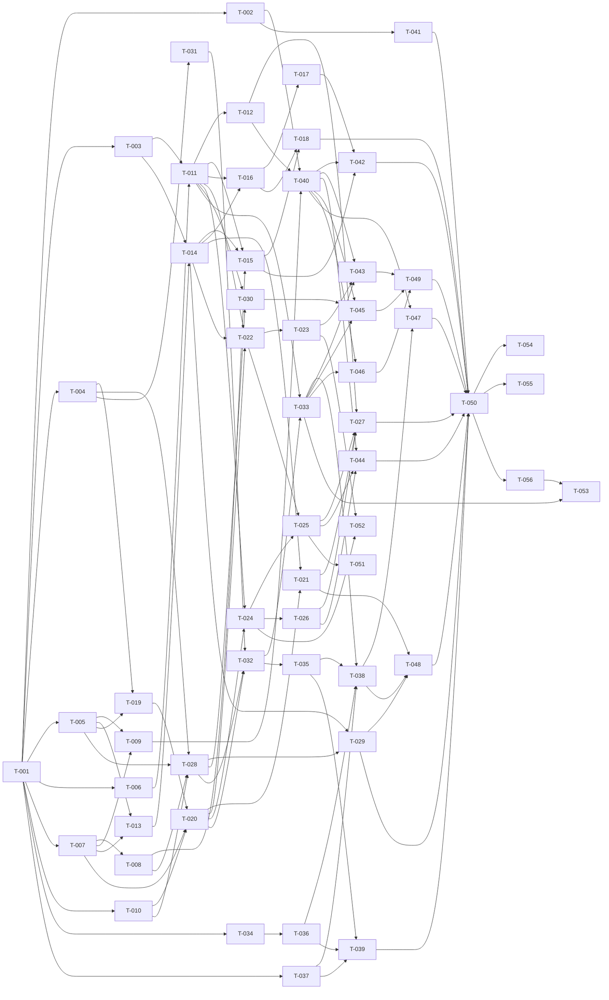

# 08 — Backlog técnico — ExpenseFlow AI

| Campo | Valor |
|---|---|
| Documento | 08-backlog.md |
| Fase | Planificación técnica (BMAD — Agente Backlog Builder) · Validación (BMAD — Agente QA de Backlog) |
| Versión | v1.0 |
| Fecha | 2026-11-10 |
| Estado | **Aprobado** |
| Aprobado por | Piero Carbajal |
| Fecha de aprobación | 2026-11-10 |
| PR de aprobación | PR que fusiona el Spec Pack v1.0 en `main` (ADR-005 §1) |
| Insumos | `03-reglas-de-negocio.md`, `05-preguntas-abiertas.md`, `06-user-stories.md`, `07-architecture.md`, `09-ui-spec.md`, `10-validation-log.md` v1.0, ADR-001 a ADR-007 v1.0 |

> **Convenciones**
> - Cada tarea T-NNN tiene: HU, reglas (RN), pantalla o componente de UI (`09`), componente de arquitectura (ARQ-NN de `07` §2.2), prioridad, tamaño, dependencias, descripción y criterio de completitud.
> - **Tamaño** (tiempo de un desarrollador asistido por un agente): **S** < 30 min · **M** 30–60 min · **L** 1–2 h. Ninguna tarea supera 2 h; si una crece, se divide antes de empezarla.
> - **Prioridad:** Must (MVP, `02` M1–M6 y habilitadores) · Should (después del MVP con el CI en verde, `02` §0).
> - **«Habilitador (todas)»:** tarea técnica que no implementa una HU concreta pero que todas necesitan.
> - Una tarea solo empieza con todas sus dependencias terminadas y su criterio de completitud cumplido. Las dependencias forman un grafo acíclico (§3), verificado por script.
> - Para el cálculo de la ruta crítica se usa el límite superior de cada tamaño: S = 0.5 h, M = 1 h, L = 2 h.
> - Cada tarea se entrega en un PR con el checklist de revisión (`/docs/checklist-revision.md`) y las pruebas de su criterio en verde.

---

## 1. Resumen
| Indicador | Valor |
|---|---|
| Tareas | 56 (50 Must, 6 Should) |
| Por tamaño | S: 14 · M: 31 · L: 11 |
| Esfuerzo máximo estimado | 60.0 h en total; 54.5 h el MVP (Must) |
| Ruta crítica del MVP | 9 tareas, 11.0 h (T-001 → T-007 → T-008 → T-028 → T-032 → T-033 → T-038 → T-047 → T-050) |
| Niveles de dependencia | 11 |
| Reglas MUST con al menos una tarea | 165 de 165 |
| HU Must con al menos una tarea | 15 de 15 |

### 1.1 Fases

| Fase | Tareas | Objetivo |
|---|---|---|
| 0 — Base | T-001 a T-012 | Solución, CI, host, `Shared`, persistencia, seed, layouts y páginas de error |
| 1 — Cuentas (M1) | T-013 a T-018 | Registro, inicio y cierre de sesión |
| 2 — Movimientos (M2, M3) | T-019 a T-027 | Gastos, ingresos, lista, edición, eliminación y aislamiento |
| 3 — Presupuesto (M4) | T-028 a T-030 | Presupuesto del mes |
| 4 — Dashboard (M5) | T-031 a T-033 | Cálculos y vista |
| 5 — IA (M6) | T-034 a T-039 | Resumen del mes y evaluaciones |
| 6 — Verificación | T-040 a T-050 | E2E de F-01 a F-07, documentación, prueba en Android y cierre |
| 7 — Post-MVP (Should) | T-051 a T-056 | Mejoras de la validación del prototipo, sesiones de usabilidad y especificación de los Should |

---

## 2. Tareas

### Fase 0 — Base
#### T-001 — Crear la solución y la estructura de módulos

| HU | Reglas | Pantalla / CMP | Componente | Prioridad | Tamaño | Depende de |
|---|---|---|---|---|---|---|
| Habilitador (todas) | — | — | ARQ-01 | Must | M | — |

**Descripción:** Crear `src/ExpenseFlow` (un proyecto, .NET 10 en `global.json`), `Directory.Packages.props` solo con los paquetes de ADR-001, `.config/dotnet-tools.json` con `dotnet-ef`, las carpetas `Modules/<Módulo>/{Domain,Application,Infrastructure,Web}` de los seis módulos con su `README.md`, `InvariantGlobalization=false` y los cinco proyectos de `tests/`.

**Criterio de completitud:** `dotnet build` compila sin advertencias; la estructura coincide con `07` §2.1; `Directory.Packages.props` no tiene rangos ni comodines.
#### T-002 — Configurar el CI bloqueante

| HU | Reglas | Pantalla / CMP | Componente | Prioridad | Tamaño | Depende de |
|---|---|---|---|---|---|---|
| Habilitador (todas) | — | — | ARQ-09 | Must | M | T-001 |

**Descripción:** Workflow de GitHub Actions con acciones fijadas por SHA: restauración, `dotnet format --verify-no-changes`, analizadores, pruebas unitarias e integración con SQL Server Express en Docker (imagen fijada por CU), `dotnet ef database update`, cobertura con coverlet (`07` §2.1, ADR-001) y revisión de paquetes vulnerables.

**Criterio de completitud:** Un PR con una prueba fallida o cobertura < 80 % en `Domain`/`Application` queda en rojo; con todo correcto queda en verde.
#### T-003 — Configurar el host web y la seguridad del transporte

| HU | Reglas | Pantalla / CMP | Componente | Prioridad | Tamaño | Depende de |
|---|---|---|---|---|---|---|
| HU-002B, HU-011 | RN-005, RN-100, RN-101, RN-140, RN-156 | — | ARQ-01 | Must | L | T-001 |

**Descripción:** Pipeline de `07` §2.3 ARQ-01: `UseExceptionHandler` y `UseHsts` fuera de `Development`, HSTS sin hosts excluidos, Kestrel solo TLS 1.2/1.3, sin compresión de respuestas, `Cache-Control: no-store` en respuestas autenticadas, filtros globales de autorización y `AutoValidateAntiforgeryTokenAttribute` con `HeaderName = X-CSRF-TOKEN`, `SuppressModelStateInvalidFilter = true`.

**Criterio de completitud:** Pruebas de integración: HTTP redirige a HTTPS, la respuesta tiene `Strict-Transport-Security`, un cliente TLS 1.1 no completa el handshake y un `POST` sin token responde `400`.
#### T-004 — Implementar los tipos de dinero de `Shared`

| HU | Reglas | Pantalla / CMP | Componente | Prioridad | Tamaño | Depende de |
|---|---|---|---|---|---|---|
| HU-003, HU-008 | RN-011, RN-013, RN-025, RN-053, RN-081, RN-104, RN-123, RN-124 | CMP-05 | ARQ-07 | Must | M | T-001 |

**Descripción:** `MoneyRounding.Mode = AwayFromZero`, `MoneyParser` (coma o punto, orden de validación de RN-104, mensajes MSG-06 a MSG-09 y MSG-11) y `MoneyFormat` («S/ 1,250.50» con U+0020, porcentajes «82.50 %»).

**Criterio de completitud:** Pruebas unitarias con `[Trait("Rule", …)]` para cada regla MUST de Cálculo listada; los casos de HU-003 (`.50`, `12.`, `1.250,50`, `0000012.50`…) pasan.
#### T-005 — Registrar `TimeProvider`, `LimaClock` y la globalización

| HU | Reglas | Pantalla / CMP | Componente | Prioridad | Tamaño | Depende de |
|---|---|---|---|---|---|---|
| HU-003, HU-014 | RN-137 | — | ARQ-07 | Must | M | T-001 |

**Descripción:** Registrar `TimeProvider.System`, `LimaClock` (`America/Lima`) y la prueba de arquitectura que busca `DateTime.Now`, `DateTime.UtcNow`, `DateTime.Today`, `DateTimeOffset.Now` y `DateTimeOffset.UtcNow` en el código y las migraciones; prueba de `es-PE` y `America/Lima` (ADR-004 §5 y §6).

**Criterio de completitud:** La prueba de arquitectura falla al introducir `DateTime.Now` y pasa sin él; la prueba de globalización pasa en el CI.
#### T-006 — Crear el catálogo de mensajes y las traducciones de códigos

| HU | Reglas | Pantalla / CMP | Componente | Prioridad | Tamaño | Depende de |
|---|---|---|---|---|---|---|
| Habilitador (todas) | RN-116 | — | ARQ-07 | Must | S | T-001 |

**Descripción:** Clase `Messages` con MSG-01 a MSG-53 copiados de `03` §10 y tabla de traducción de los enums al español (`07` §3.1).

**Criterio de completitud:** Una prueba compara cada texto con `03` §10 (fuente única) y falla si falta o difiere uno.
#### T-007 — Crear el modelo de datos y la migración inicial

| HU | Reglas | Pantalla / CMP | Componente | Prioridad | Tamaño | Depende de |
|---|---|---|---|---|---|---|
| HU-011, HU-014 | RN-007, RN-010, RN-012, RN-017, RN-064 | — | ARQ-08 | Must | L | T-001 |

**Descripción:** `ExpenseFlowDbContext`, `ApplicationUser`, entidades `Transaction` y `Budget` con `decimal(18,2)`, restricciones `CHECK`, índices de `07` §3.1, `UX_Budgets_UserId_Year_Month` y filtro global por `UserId` (sin usuario no devuelve filas). Migración inicial aditiva.

**Criterio de completitud:** `dotnet ef database update` crea el esquema en el contenedor del CI; una prueba verifica que el código no llama a `Database.Migrate()`.
#### T-008 — Traducir las violaciones de unicidad de SQL Server

| HU | Reglas | Pantalla / CMP | Componente | Prioridad | Tamaño | Depende de |
|---|---|---|---|---|---|---|
| HU-001, HU-007 | RN-064, RN-095 | — | ARQ-08 | Must | S | T-007 |

**Descripción:** En `Shared.Infrastructure`, traducir `SqlException.Number` 2601 y 2627 a excepciones de dominio (`BudgetAlreadyExists`, `EmailAlreadyExists`) (ADR-007).

**Criterio de completitud:** Prueba de integración: insertar dos presupuestos del mismo mes produce la excepción de dominio, no `SqlException`.
#### T-009 — Implementar el seed de las cuentas demo

| HU | Reglas | Pantalla / CMP | Componente | Prioridad | Tamaño | Depende de |
|---|---|---|---|---|---|---|
| HU-014 | RN-138, RN-157, RN-158, RN-159 | — | ARQ-08 | Must | M | T-005, T-007 |

**Descripción:** `DemoSeeder` idempotente que borra y recrea `demo1` a `demo6` con `Demo#2026x`, los movimientos de `03` §11.2 y `CreatedAt` crecientes de 1 s, sin tocar otras cuentas; comando para ejecutarlo desde el CI.

**Criterio de completitud:** Los seis criterios de HU-014 pasan, incluida la doble ejecución y la conservación de cuentas `e2e-<GUID>`.
#### T-010 — Implementar `ICurrentUser` y las pruebas de fronteras

| HU | Reglas | Pantalla / CMP | Componente | Prioridad | Tamaño | Depende de |
|---|---|---|---|---|---|---|
| HU-011 | RN-007, RN-103 | — | ARQ-07 | Must | S | T-001 |

**Descripción:** `ICurrentUser.UserId` tomado del `ClaimsPrincipal`; prueba de arquitectura que impide que un módulo use entidades de otro y que los DTO de entrada tengan `UserId` (DP-3, DP-8).

**Criterio de completitud:** La prueba de arquitectura falla al referenciar `Transactions.Domain` desde `Budgets` y pasa sin esa referencia.
#### T-011 — Construir los layouts, los tokens y los componentes de formulario

| HU | Reglas | Pantalla / CMP | Componente | Prioridad | Tamaño | Depende de |
|---|---|---|---|---|---|---|
| HU-001, HU-003 | RN-099, RN-116, RN-168 | CMP-01, CMP-02, CMP-03, CMP-04, CMP-10 | ARQ-01 | Must | L | T-003, T-006 |

**Descripción:** Layouts CMP-01 y CMP-02, `site.css` con los tokens de `09` §4, Bootstrap local, vistas parciales CMP-03 (etiqueta, ayuda, error con `aria-describedby`) y CMP-04 (resumen MSG-44 sin foco), bloque de errores que no son de un campo con `role="alert"`, bloque de confirmación con `role="status"` y script de mejora progresiva (`data-disable-on-submit`, foco en el primer campo con error).

**Criterio de completitud:** Una página de prueba con un formulario inválido muestra CMP-04, el error junto al campo y el foco en el primer campo con error; axe no reporta infracciones.
#### T-012 — Crear las páginas de error 500, 404 y 400

| HU | Reglas | Pantalla / CMP | Componente | Prioridad | Tamaño | Depende de |
|---|---|---|---|---|---|---|
| HU-011, HU-013 | RN-164, RN-169, RN-170 | P-011, P-012, P-016 | ARQ-01 | Must | M | T-011 |

**Descripción:** Vista `/Error` con MSG-40 y `500`; página `404` con MSG-45 para rutas inexistentes y recursos ajenos; página `400` con MSG-46 para el rechazo antiforgery en MVC; `ProblemDetails` con `code` MSG-40 en la API. Las tres con el enlace «Volver al inicio».

**Criterio de completitud:** Los criterios de HU-013 y los de páginas `404` y `400` de HU-011 pasan; ninguna página muestra trazas ni textos en inglés fuera de `Development`.

### Fase 1 — Cuentas (M1)
#### T-013 — Verificar que Identity usa el `TimeProvider` registrado

| HU | Reglas | Pantalla / CMP | Componente | Prioridad | Tamaño | Depende de |
|---|---|---|---|---|---|---|
| HU-002A | RN-048, RN-137 | — | ARQ-02 | Must | S | T-005, T-007 |

**Descripción:** Prueba de concepto de PQ-09 (riesgo RA-05): registrar Identity con el `TimeProvider` de la aplicación y comprobar con `FakeTimeProvider` que el bloqueo de 5 minutos termina al avanzar el reloj.

**Criterio de completitud:** La prueba de concepto pasa, o la limitación queda documentada en `07` §6.3 y la prueba de RN-048 se ajusta; PQ-09 se cierra en `05`.
#### T-014 — Configurar Identity y la cookie de autenticación

| HU | Reglas | Pantalla / CMP | Componente | Prioridad | Tamaño | Depende de |
|---|---|---|---|---|---|---|
| HU-002A, HU-002B | RN-003, RN-004, RN-048, RN-094, RN-095, RN-096, RN-097, RN-098, RN-102, RN-144, RN-145, RN-147 | — | ARQ-02 | Must | M | T-003, T-013 |

**Descripción:** `AddIdentityCore<ApplicationUser>().AddSignInManager().AddEntityFrameworkStores()` y `AddAuthentication(IdentityConstants.ApplicationScheme).AddIdentityCookies()` con las opciones de `07` §2.3 ARQ-02; cookie no persistente de 60 min con renovación; `OnRedirectToLogin` ⇒ `401` con `ProblemDetails` en `/api/*`; cookie de marca `ef_session`.

**Criterio de completitud:** `GET /api/transactions` sin cookie responde `401` con `ProblemDetails`; `Set-Cookie` no tiene `Expires`; `/Identity/Account/Manage` responde `404`.
#### T-015 — Implementar «Crear cuenta»

| HU | Reglas | Pantalla / CMP | Componente | Prioridad | Tamaño | Depende de |
|---|---|---|---|---|---|---|
| HU-001 | RN-001, RN-002, RN-094, RN-099, RN-148, RN-149, RN-150, RN-151, RN-152, RN-153, RN-173 | P-001 | ARQ-02 | Must | L | T-008, T-011, T-014 |

**Descripción:** Vista P-001 con 4 campos, MSG-05 y MSG-47; validador propio con el orden de RN-149 y RN-152; casilla conservada tras un error; `UserName` = correo; inicio de sesión automático y `303` a `/dashboard`; usuario autenticado ⇒ `/dashboard`.

**Criterio de completitud:** Los 18 criterios de HU-001 pasan en pruebas unitarias y de integración (E2E en T-042).
#### T-016 — Implementar «Iniciar sesión»

| HU | Reglas | Pantalla / CMP | Componente | Prioridad | Tamaño | Depende de |
|---|---|---|---|---|---|---|
| HU-002A | RN-006, RN-049, RN-050, RN-146, RN-154, RN-155, RN-171, RN-173, RN-174 | P-002 | ARQ-02 | Must | L | T-011, T-014 |

**Descripción:** Vista P-002 sin «Recordarme»; MSG-02 único en bloque `role="alert"`; `returnUrl` local en campo oculto, conservado tras errores y mapeado a la página del formulario si la ruta solo admite `POST`; correo sin espacios exteriores; MSG-48 cuando la llegada es por expiración.

**Criterio de completitud:** Los criterios de HU-002A pasan en integración, incluido el bloqueo con `FakeTimeProvider` en una cuenta `e2e-<GUID>`.
#### T-017 — Implementar el cierre de sesión y el aviso de expiración

| HU | Reglas | Pantalla / CMP | Componente | Prioridad | Tamaño | Depende de |
|---|---|---|---|---|---|---|
| HU-002B | RN-097, RN-098, RN-171, RN-177 | CMP-01, P-002 | ARQ-02 | Must | M | T-016 |

**Descripción:** `POST /account/logout` con `[AllowAnonymous]`: con sesión, elimina la cookie de autenticación y la cookie de marca; sin sesión, `303` al inicio de sesión sin validar el token. Detección de expiración (cookie de marca sin cookie de autenticación ⇒ `reason=expired`).

**Criterio de completitud:** Los criterios de HU-002B pasan con `FakeTimeProvider`: MSG-48 solo tras expirar, nunca tras «Cerrar sesión» ni en el primer acceso.
#### T-018 — Probar los casos límite de las cuentas

| HU | Reglas | Pantalla / CMP | Componente | Prioridad | Tamaño | Depende de |
|---|---|---|---|---|---|---|
| HU-001, HU-002A | RN-006, RN-048, RN-095 | — | ARQ-09 | Must | M | T-015, T-016 |

**Descripción:** Pruebas de integración: dos registros simultáneos con el mismo correo (uno falla con MSG-04), el log no contiene contraseñas, contadores de bloqueo con cuentas `e2e-<GUID>`.

**Criterio de completitud:** Las pruebas pasan contra SQL Server real en el CI y existe 1 sola cuenta tras el registro simultáneo.

### Fase 2 — Movimientos (M2, M3)
#### T-019 — Modelar el dominio de movimientos

| HU | Reglas | Pantalla / CMP | Componente | Prioridad | Tamaño | Depende de |
|---|---|---|---|---|---|---|
| HU-003, HU-004, HU-006 | RN-014, RN-015, RN-016, RN-019, RN-021, RN-051, RN-052, RN-054, RN-055, RN-056, RN-057, RN-058, RN-059, RN-060, RN-061, RN-105, RN-106, RN-107, RN-109, RN-110, RN-111, RN-160 | — | ARQ-03 | Must | M | T-004, T-005 |

**Descripción:** Entidad `Transaction` con fábricas por tipo, catálogos cerrados, ventana de fechas (≤ hoy de Lima y ≥ inicio de la ventana de 12 meses) y descarte de la descripción al cambiar el origen.

**Criterio de completitud:** Pruebas unitarias de cada regla con su ejemplo y contraejemplo; las reglas MUST de Cálculo llevan `Trait`.
#### T-020 — Implementar el servicio de movimientos

| HU | Reglas | Pantalla / CMP | Componente | Prioridad | Tamaño | Depende de |
|---|---|---|---|---|---|---|
| HU-003, HU-005, HU-006 | RN-007, RN-008, RN-018, RN-020, RN-079, RN-108, RN-115, RN-117 | — | ARQ-03 | Must | M | T-007, T-010, T-019 |

**Descripción:** `TransactionService`: crear, reemplazar, eliminar físicamente y listar por `userId`, orden `Date DESC, CreatedAt DESC, Id DESC`, páginas de 20 y medio de pago preseleccionado.

**Criterio de completitud:** Pruebas de integración de orden, paginación (20/21 movimientos), preselección y `404` para recursos ajenos.
#### T-021 — Exponer la API de movimientos

| HU | Reglas | Pantalla / CMP | Componente | Prioridad | Tamaño | Depende de |
|---|---|---|---|---|---|---|
| HU-003, HU-004, HU-006, HU-011 | RN-053, RN-101, RN-103, RN-112, RN-113 | — | ARQ-03 | Must | L | T-014, T-020 |

**Descripción:** Endpoints de ADR-004 §3.2 para movimientos con la precedencia de ADR-004 §3.1 y los errores de formato MSG-26 a MSG-30, MSG-38, MSG-39 y MSG-43.

**Criterio de completitud:** Los criterios de API de HU-003, HU-004 y HU-006 pasan; `PUT` con `type` distinto sobre un recurso ajeno responde `404`.
#### T-022 — Implementar «Nuevo gasto»

| HU | Reglas | Pantalla / CMP | Componente | Prioridad | Tamaño | Depende de |
|---|---|---|---|---|---|---|
| HU-003 | RN-018, RN-057, RN-104, RN-108, RN-116, RN-168, RN-172 | P-004, CMP-05, CMP-06 | ARQ-03 | Must | M | T-011, T-014, T-020 |

**Descripción:** Vista P-004 con 4 campos, fecha propuesta de Lima, medio preseleccionado, botón deshabilitado al enviar y `303` a `/dashboard` con MSG-49.

**Criterio de completitud:** Los criterios MVC de HU-003 pasan en integración; el formulario funciona sin JavaScript.
#### T-023 — Implementar «Nuevo ingreso»

| HU | Reglas | Pantalla / CMP | Componente | Prioridad | Tamaño | Depende de |
|---|---|---|---|---|---|---|
| HU-004 | RN-058, RN-059, RN-060, RN-061, RN-110, RN-168, RN-172 | P-005, CMP-05, CMP-06 | ARQ-03 | Must | M | T-022 |

**Descripción:** Vista P-005 con origen, «Descripción» visible con «Otros» (siempre visible sin JavaScript), descarte de la descripción con otro origen (DEC-66) y `303` a `/dashboard` con MSG-50.

**Criterio de completitud:** Los criterios MVC de HU-004 pasan, incluido el caso sin JavaScript de DEC-66.
#### T-024 — Implementar la lista de movimientos

| HU | Reglas | Pantalla / CMP | Componente | Prioridad | Tamaño | Depende de |
|---|---|---|---|---|---|---|
| HU-005 | RN-079, RN-080, RN-117, RN-125, RN-162 | P-006, CMP-07, CMP-12 | ARQ-03 | Must | M | T-011, T-020 |

**Descripción:** Vista P-006 con filas CMP-07 (« · » como texto), paginación CMP-12, MSG-31 tras la última página y MSG-41 sin movimientos; página inválida ⇒ 1.

**Criterio de completitud:** Los criterios de HU-005 pasan con `demo6` y `demo4`.
#### T-025 — Implementar «Editar movimiento»

| HU | Reglas | Pantalla / CMP | Componente | Prioridad | Tamaño | Depende de |
|---|---|---|---|---|---|---|
| HU-006 | RN-109, RN-110, RN-111, RN-112, RN-160, RN-168, RN-172 | P-007 | ARQ-03 | Must | M | T-022, T-024 |

**Descripción:** Vista P-007 precargada, `page` de origen en campo oculto, «Cancelar» a `/transactions?page=n`, `303` a la misma página con MSG-51.

**Criterio de completitud:** Los criterios de edición de HU-006 pasan, incluido MSG-17 para un movimiento fuera de la ventana.
#### T-026 — Implementar la eliminación con confirmación

| HU | Reglas | Pantalla / CMP | Componente | Prioridad | Tamaño | Depende de |
|---|---|---|---|---|---|---|
| HU-006 | RN-020, RN-114, RN-115, RN-172, RN-178 | P-008, CMP-11 | ARQ-03 | Must | M | T-024 |

**Descripción:** `
` sin JavaScript y `<dialog>` con JavaScript (DEC-67), `POST /transactions/{id}/delete` con `page`, MSG-52 y página *n* − 1 si la página quedó vacía.

**Criterio de completitud:** Los criterios de eliminación de HU-006 pasan; con «Cancelar» el foco vuelve al botón «Eliminar» de la fila.
#### T-027 — Probar el aislamiento de datos de punta a punta

| HU | Reglas | Pantalla / CMP | Componente | Prioridad | Tamaño | Depende de |
|---|---|---|---|---|---|---|
| HU-011 | RN-007, RN-008, RN-009, RN-101, RN-102, RN-103, RN-169, RN-170 | P-012, P-016 | ARQ-09 | Must | M | T-012, T-021, T-025, T-026 |

**Descripción:** Pruebas de integración de HU-011 sobre API y MVC: `404` idéntico para ajeno e inexistente, `401` antes que `400`, token previo al inicio de sesión inválido, `userId` del cuerpo ignorado.

**Criterio de completitud:** Los 13 criterios de HU-011 pasan (KPI T2: 0 accesos exitosos a datos ajenos).

### Fase 3 — Presupuesto (M4)
#### T-028 — Implementar el servicio de presupuesto

| HU | Reglas | Pantalla / CMP | Componente | Prioridad | Tamaño | Depende de |
|---|---|---|---|---|---|---|
| HU-007 | RN-022, RN-062, RN-063, RN-064, RN-065, RN-118, RN-119, RN-139, RN-167 | — | ARQ-04 | Must | M | T-004, T-005, T-008, T-010 |

**Descripción:** `BudgetService`: crear y editar solo el mes en curso de Lima, `Id` conservado, colisión ⇒ MSG-21, mes del formulario distinto del actual ⇒ MSG-22, sin eliminación.

**Criterio de completitud:** Pruebas unitarias e integración de cada regla; dos creaciones simultáneas dejan 1 solo registro.
#### T-029 — Exponer la API de presupuesto

| HU | Reglas | Pantalla / CMP | Componente | Prioridad | Tamaño | Depende de |
|---|---|---|---|---|---|---|
| HU-007, HU-011 | RN-008, RN-068, RN-119 | — | ARQ-04 | Must | S | T-014, T-028 |

**Descripción:** `GET /api/budgets/current` (`204` sin presupuesto), `POST` (`201`/`409`), `PUT` (`200`/`400` MSG-22/`404`); `DELETE` responde `405`.

**Criterio de completitud:** Los criterios de API de HU-007 pasan, incluido el `POST` simultáneo (un `201` y un `409`).
#### T-030 — Implementar «Crear presupuesto» y «Editar presupuesto»

| HU | Reglas | Pantalla / CMP | Componente | Prioridad | Tamaño | Depende de |
|---|---|---|---|---|---|---|
| HU-007 | RN-064, RN-167, RN-168, RN-172, RN-175, RN-176 | P-009, P-010 | ARQ-04 | Must | M | T-011, T-028 |

**Descripción:** Vistas P-009 y P-010 con el mes en el rótulo y en el campo oculto, MSG-21/MSG-22 en bloque `role="alert"`, nueva presentación con el mes nuevo (DEC-84), redirecciones cruzadas y `303` a `/dashboard` con MSG-53.

**Criterio de completitud:** Los criterios MVC de HU-007 pasan, incluidas las redirecciones de RN-175 y RN-176.

### Fase 4 — Dashboard (M5)
#### T-031 — Implementar `DashboardCalculator`

| HU | Reglas | Pantalla / CMP | Componente | Prioridad | Tamaño | Depende de |
|---|---|---|---|---|---|---|
| HU-008, HU-009 | RN-023, RN-024, RN-025, RN-026, RN-028, RN-029, RN-030, RN-031, RN-032, RN-033, RN-066, RN-067, RN-071, RN-072, RN-073, RN-074, RN-075, RN-120, RN-121, RN-122 | — | ARQ-05 | Must | L | T-004 |

**Descripción:** Cálculo puro (sin E/S) en `Dashboard.Domain` de totales, porcentaje, restante, exceso, saldos, avisos y totales por categoría, con `MoneyRounding.Mode`.

**Criterio de completitud:** Pruebas unitarias con `Trait` de todas las reglas MUST de Cálculo del dashboard, incluidos 79.99, 80.00, 99.99, 99.995 y 100.00 %.
#### T-032 — Implementar la consulta y la API del dashboard

| HU | Reglas | Pantalla / CMP | Componente | Prioridad | Tamaño | Depende de |
|---|---|---|---|---|---|---|
| HU-008, HU-009, HU-011 | RN-027, RN-076, RN-077, RN-078, RN-079 | — | ARQ-05 | Must | M | T-020, T-028, T-031 |

**Descripción:** `DashboardQueryService` filtrado por `userId`, `GetMonthAggregates` para Insights y `GET /api/dashboard` con `DashboardDto` (ADR-004 §3.3).

**Criterio de completitud:** Los JSON de `demo1`, `demo2` y `demo3` coinciden con `07` §4.7.
#### T-033 — Construir la vista del dashboard

| HU | Reglas | Pantalla / CMP | Componente | Prioridad | Tamaño | Depende de |
|---|---|---|---|---|---|---|
| HU-008, HU-009 | RN-013, RN-068, RN-069, RN-070, RN-078, RN-080, RN-081, RN-123, RN-124, RN-126, RN-127, RN-141, RN-142, RN-162, RN-163, RN-172 | P-003, CMP-07, CMP-08, CMP-09 | ARQ-05 | Must | L | T-011, T-032 |

**Descripción:** Vista P-003 con saldos (`<h2>`/`<h3>`), leyenda, barra CMP-08 con ARIA, aviso CMP-09 con `role="status"`, gasto por categoría, 5 últimos movimientos, estados vacíos, confirmaciones de RN-172 y literales de DEC-83.

**Criterio de completitud:** Los criterios de HU-008 y HU-009 pasan en integración con `demo1` a `demo6`; las cifras son idénticas con JavaScript deshabilitado.

### Fase 5 — IA (M6)
#### T-034 — Validar la configuración de la IA

| HU | Reglas | Pantalla / CMP | Componente | Prioridad | Tamaño | Depende de |
|---|---|---|---|---|---|---|
| HU-010B | RN-084, RN-085, RN-132, RN-134 | — | ARQ-06 | Must | S | T-001 |

**Descripción:** `AiOptionsValidator` al arrancar: URL absoluta, hosts de ADR-002 comparados por tipo, modelo no vacío y tiempo de espera de 5 a 120 s (si no, 30 con advertencia).

**Criterio de completitud:** Los criterios de configuración de HU-010B pasan como pruebas unitarias; la aplicación arranca con la IA deshabilitada.
#### T-035 — Construir el payload y las instrucciones del modelo

| HU | Reglas | Pantalla / CMP | Componente | Prioridad | Tamaño | Depende de |
|---|---|---|---|---|---|---|
| HU-010A | RN-034, RN-035, RN-042, RN-129 | — | ARQ-06 | Must | M | T-032 |

**Descripción:** `PayloadBuilder` con los 9 campos de RN-034 (categorías en español, `null` sin presupuesto) e instrucciones `Prompts/monthly-summary.v1.md`.

**Criterio de completitud:** Prueba de integración: el JSON de `demo1` coincide con `07` §4.8 y no contiene correo, nombre ni `UserId`.
#### T-036 — Implementar `OllamaClient`

| HU | Reglas | Pantalla / CMP | Componente | Prioridad | Tamaño | Depende de |
|---|---|---|---|---|---|---|
| HU-010B | RN-036, RN-038, RN-082, RN-083, RN-086, RN-087, RN-088, RN-133 | — | ARQ-06 | Must | M | T-034 |

**Descripción:** Cliente con `IHttpClientFactory`, `POST /api/generate` con `stream: false` y `think: false`, tiempo de espera configurado, sin reintentos, eliminación de `<think>…</think>`, fallos tipificados y log sin datos personales.

**Criterio de completitud:** Pruebas unitarias e integración con el cliente simulado: tiempo agotado, conexión, `404`, respuesta vacía; 1 sola llamada por solicitud.
#### T-037 — Implementar `FigureVerifier`

| HU | Reglas | Pantalla / CMP | Componente | Prioridad | Tamaño | Depende de |
|---|---|---|---|---|---|---|
| HU-010B | RN-130, RN-166 | — | ARQ-06 | Must | M | T-001 |

**Descripción:** Detección, normalización y comparación por valor absoluto de ADR-003 §3, con los valores permitidos 80 %, 100 % y 0.

**Criterio de completitud:** Las 5 filas de ejemplo de ADR-003 §3 pasan como pruebas unitarias con `Trait`.
#### T-038 — Implementar el resumen del mes

| HU | Reglas | Pantalla / CMP | Componente | Prioridad | Tamaño | Depende de |
|---|---|---|---|---|---|---|
| HU-010A, HU-010B | RN-037, RN-039, RN-040, RN-041, RN-043, RN-128, RN-131, RN-165, RN-166 | P-003, CMP-10 | ARQ-06 | Must | L | T-033, T-035, T-036, T-037 |

**Descripción:** `MonthlySummaryService`, `POST /insights/monthly-summary` con PRG y TempData de un solo uso, encabezado y descargo, MSG-23/MSG-24, botón deshabilitado con «Generando resumen…» y `POST /api/insights/monthly-summary` con `503`.

**Criterio de completitud:** Los criterios de HU-010A y HU-010B pasan con el cliente simulado; recargar no vuelve a llamar a Ollama.
#### T-039 — Crear las evaluaciones de IA con Ollama real

| HU | Reglas | Pantalla / CMP | Componente | Prioridad | Tamaño | Depende de |
|---|---|---|---|---|---|---|
| HU-010B | RN-129, RN-130 | — | ARQ-09 | Must | M | T-035, T-036, T-037 |

**Descripción:** Consola `ExpenseFlow.AiEvals` con los 10 escenarios de ADR-003 §2 y el reporte `ai-eval-report.md` con modelo, digest y resultados.

**Criterio de completitud:** La ejecución local con `qwen3:4b` obtiene 10/10 y el reporte se adjunta al PR.

### Fase 6 — Verificación
#### T-040 — Preparar la infraestructura E2E

| HU | Reglas | Pantalla / CMP | Componente | Prioridad | Tamaño | Depende de |
|---|---|---|---|---|---|---|
| Habilitador (todas) | RN-157 | — | ARQ-09 | Must | L | T-002, T-009, T-012 |

**Descripción:** `WebApplicationFactory` sobre Kestrel con HTTPS en `Testing`, cliente de IA simulado con `ConfigureTestServices`, Playwright con axe, ayudante de cuentas `e2e-<GUID>` y seed antes de cada corrida (ADR-004 §4.1).

**Criterio de completitud:** Una prueba E2E de humo abre P-002 en el CI y axe no reporta infracciones.
#### T-041 — Verificar en el CI los `Trait` de las reglas de cálculo

| HU | Reglas | Pantalla / CMP | Componente | Prioridad | Tamaño | Depende de |
|---|---|---|---|---|---|---|
| Habilitador (todas) | — | — | ARQ-09 | Must | S | T-002 |

**Descripción:** Script `pwsh` que extrae de `03` las reglas de categoría Cálculo y prioridad MUST y falla si alguna no tiene una prueba con su `Trait` (ADR-001 §3).

**Criterio de completitud:** El paso falla al quitar el `Trait` de RN-028 y pasa con él.
#### T-042 — Escribir las E2E del flujo F-01

| HU | Reglas | Pantalla / CMP | Componente | Prioridad | Tamaño | Depende de |
|---|---|---|---|---|---|---|
| HU-001, HU-002A, HU-002B | RN-146, RN-171, RN-177 | P-001, P-002, CMP-01 | ARQ-09 | Must | M | T-015, T-017, T-040 |

**Descripción:** Registro con `e2e-<GUID>`, inicio y cierre de sesión, `returnUrl`, sesión expirada con MSG-48 y cierre sin sesión.

**Criterio de completitud:** Los criterios E2E de HU-001, HU-002A y HU-002B pasan en el CI.
#### T-043 — Escribir las E2E de los flujos F-02 y F-04

| HU | Reglas | Pantalla / CMP | Componente | Prioridad | Tamaño | Depende de |
|---|---|---|---|---|---|---|
| HU-003, HU-004 | RN-108, RN-168, RN-172 | P-004, P-005, P-003 | ARQ-09 | Must | M | T-023, T-033, T-040 |

**Descripción:** Registro de gasto e ingreso, preselección, doble envío con respuesta retrasada, confirmaciones MSG-49 y MSG-50, teclado y axe.

**Criterio de completitud:** Los criterios E2E de HU-003 y HU-004 pasan en el CI.
#### T-044 — Escribir las E2E del flujo F-03

| HU | Reglas | Pantalla / CMP | Componente | Prioridad | Tamaño | Depende de |
|---|---|---|---|---|---|---|
| HU-005, HU-006 | RN-114, RN-117, RN-178 | P-006, P-007, P-008 | ARQ-09 | Must | M | T-025, T-026, T-040 |

**Descripción:** Lista paginada con `demo6`, edición desde la página 2, «Cancelar», eliminación con y sin JavaScript y foco tras cancelar.

**Criterio de completitud:** Los criterios E2E de HU-005 y HU-006 pasan en el CI.
#### T-045 — Escribir las E2E del flujo F-05

| HU | Reglas | Pantalla / CMP | Componente | Prioridad | Tamaño | Depende de |
|---|---|---|---|---|---|---|
| HU-007 | RN-172, RN-175 | P-009, P-010 | ARQ-09 | Must | S | T-030, T-033, T-040 |

**Descripción:** Crear y editar el presupuesto con una cuenta `e2e-<GUID>` y comprobarlo en el dashboard.

**Criterio de completitud:** Los criterios E2E de HU-007 pasan en el CI.
#### T-046 — Escribir las E2E del flujo F-06

| HU | Reglas | Pantalla / CMP | Componente | Prioridad | Tamaño | Depende de |
|---|---|---|---|---|---|---|
| HU-008, HU-009 | RN-027, RN-141 | P-003 | ARQ-09 | Must | M | T-033, T-040 |

**Descripción:** Dashboard de `demo1` a `demo6` a 360 px y en escritorio, con y sin JavaScript, avisos, barra y axe.

**Criterio de completitud:** Los criterios E2E de HU-008 y HU-009 pasan en el CI.
#### T-047 — Escribir las E2E del flujo F-07

| HU | Reglas | Pantalla / CMP | Componente | Prioridad | Tamaño | Depende de |
|---|---|---|---|---|---|---|
| HU-010A | RN-128, RN-131, RN-165 | P-003 | ARQ-09 | Must | M | T-038, T-040 |

**Descripción:** Resumen con el cliente simulado: éxito, MSG-23, MSG-24, doble pulsación y texto con `<script>` mostrado como literal.

**Criterio de completitud:** Los criterios E2E de HU-010A pasan en el CI.
#### T-048 — Documentar el proyecto y la API

| HU | Reglas | Pantalla / CMP | Componente | Prioridad | Tamaño | Depende de |
|---|---|---|---|---|---|---|
| Habilitador (todas) | — | — | ARQ-01 | Must | S | T-021, T-029, T-038 |

**Descripción:** README raíz (instalación de SQL Server Express y Ollama, credenciales demo, `mkcert`), README de cada módulo con diagramas Mermaid, Swagger en `Development` y digest del modelo en el README de `Insights`.

**Criterio de completitud:** El checklist §6 queda completo y Swagger lista todos los endpoints de ADR-004 §3.2.
#### T-049 — Probar el entorno `Demo` desde Android

| HU | Reglas | Pantalla / CMP | Componente | Prioridad | Tamaño | Depende de |
|---|---|---|---|---|---|---|
| HU-003, HU-007, HU-008 | RN-156 | P-003, P-004, P-009 | ARQ-01 | Must | S | T-043, T-045, T-046 |

**Descripción:** Levantar `Demo` con certificado `mkcert` y ejecutar F-02, F-05 y F-06 desde un Android en la red local (KPI T4).

**Criterio de completitud:** Los tres flujos se completan desde Android y se registra la evidencia en el PR.
#### T-050 — Cerrar la verificación del MVP

| HU | Reglas | Pantalla / CMP | Componente | Prioridad | Tamaño | Depende de |
|---|---|---|---|---|---|---|
| Habilitador (todas) | — | — | ARQ-09 | Must | S | T-018, T-027, T-029, T-039, T-041, T-042, T-044, T-047, T-048, T-049 |

**Descripción:** Revisar con el checklist que el CI está en verde, la cobertura ≥ 80 %, los `Trait` completos y el reporte de IA 10/10 adjunto.

**Criterio de completitud:** El checklist de revisión queda completo para el PR de cierre del MVP.

### Fase 7 — Post-MVP (Should)
#### T-051 — Mostrar MSG-17 al abrir un movimiento fuera de la ventana

| HU | Reglas | Pantalla / CMP | Componente | Prioridad | Tamaño | Depende de |
|---|---|---|---|---|---|---|
| HU-006 | RN-109 | P-007 | ARQ-03 | Should | S | T-025 |

**Descripción:** Mejora de la validación del prototipo (V-27): mostrar MSG-17 como aviso al cargar P-007 cuando el movimiento ya está fuera de la ventana. Antes de iniciarla se registra la decisión y la regla en `03`.

**Criterio de completitud:** Existe la decisión en `03` §9 y un criterio nuevo en HU-006 que pasa.
#### T-052 — Volver a la lista tras guardar un movimiento abierto desde ella

| HU | Reglas | Pantalla / CMP | Componente | Prioridad | Tamaño | Depende de |
|---|---|---|---|---|---|---|
| HU-003, HU-004 | RN-172 | P-004, P-005, P-006 | ARQ-03 | Should | S | T-023, T-024 |

**Descripción:** Mejora de la validación del prototipo (V-25): si «Nuevo gasto» o «Nuevo ingreso» se abrió desde P-006, volver a la lista con la confirmación. Antes de iniciarla se registra la decisión y la regla en `03`.

**Criterio de completitud:** Existe la decisión en `03` §9 y un criterio nuevo en HU-003 y HU-004 que pasa.
#### T-053 — Parametrizar la barra de consumo para los Should

| HU | Reglas | Pantalla / CMP | Componente | Prioridad | Tamaño | Depende de |
|---|---|---|---|---|---|---|
| HU-015, HU-017 | RN-044, RN-046 | CMP-08, P-014, P-015 | ARQ-05 | Should | S | T-033, T-056 |

**Descripción:** Al especificar S1 y S4 (`05` PQ-08), parametrizar en CMP-08 el `aria-label` y la escala de color (V-28).

**Criterio de completitud:** CMP-08 acepta `aria-label` y escala por parámetro y las pruebas de HU-008 siguen pasando.
#### T-054 — Preparar y medir las sesiones de usabilidad

| HU | Reglas | Pantalla / CMP | Componente | Prioridad | Tamaño | Depende de |
|---|---|---|---|---|---|---|
| HU-001, HU-002A, HU-003, HU-007, HU-010A | RN-050, RN-148 | P-001, P-002, P-003, P-004, P-009 | ARQ-09 | Should | M | T-050 |

**Descripción:** Guion de las sesiones U1 a U4 con cuentas demo, incluida la medición del efecto de MSG-02 con cuenta bloqueada (V-29) y del tiempo de registro con contraseñas vaciadas (V-30). Requiere cerrar PQ-01 y PQ-02.

**Criterio de completitud:** El guion está aprobado por el PO y la plantilla de resultados mide U1 a U4, V-29 y V-30.
#### T-055 — Especificar S2 y cerrar PQ-07

| HU | Reglas | Pantalla / CMP | Componente | Prioridad | Tamaño | Depende de |
|---|---|---|---|---|---|---|
| HU-012 | RN-089, RN-090, RN-091, RN-092, RN-093, RN-135, RN-136, RN-143, RN-161 | P-013 | ARQ-05 | Should | M | T-050 |

**Descripción:** Redactar con el PO los mensajes de rechazo de RN-143 y RN-161 y el rótulo del saldo del periodo (`03` §10), completar los criterios de HU-012 y la ficha de P-013 en `09`, y desglosar sus tareas de implementación.

**Criterio de completitud:** PQ-07 queda cerrada en `05`; HU-012 cumple INVEST y la Definition of Ready; P-013 tiene ruta y wireframe.
#### T-056 — Especificar S1, S3, S4 y S5 y cerrar PQ-08

| HU | Reglas | Pantalla / CMP | Componente | Prioridad | Tamaño | Depende de |
|---|---|---|---|---|---|---|
| HU-015, HU-016, HU-017, HU-018 | RN-044, RN-045, RN-046, RN-047 | P-006, P-014, P-015, CMP-08 | ARQ-05 | Should | L | T-050 |

**Descripción:** Redactar con el PO las reglas, mensajes y criterios que faltan para HU-015 a HU-018 (modelo de datos de S1, filtros de S3, cómo se marca un monto como ahorro en S4, payload e instrucciones de S5), sus fichas de UI y sus tareas de implementación.

**Criterio de completitud:** PQ-08 queda cerrada en `05`; HU-015 a HU-018 pasan de «Propuesta» a lista con criterios verificables.
---

## 3. Grafo de dependencias

> Verificación por script (orden topológico de Kahn): **sin ciclos**, todas las dependencias existen y ninguna tarea depende de sí misma.

### 3.1 Niveles (tareas que pueden avanzar en paralelo)

| Nivel | Tareas |
|---|---|
| 1 | T-001 |
| 2 | T-002, T-003, T-004, T-005, T-006, T-007, T-010, T-034, T-037 |
| 3 | T-008, T-009, T-011, T-013, T-019, T-031, T-036, T-041 |
| 4 | T-012, T-014, T-020, T-028 |
| 5 | T-015, T-016, T-021, T-022, T-024, T-029, T-030, T-032, T-040 |
| 6 | T-017, T-018, T-023, T-025, T-026, T-033, T-035 |
| 7 | T-027, T-038, T-039, T-042, T-043, T-044, T-045, T-046, T-051, T-052 |
| 8 | T-047, T-048, T-049 |
| 9 | T-050 |
| 10 | T-054, T-055, T-056 |
| 11 | T-053 |

---

## 4. Ruta crítica del MVP

T-001 → T-007 → T-008 → T-028 → T-032 → T-033 → T-038 → T-047 → T-050

| Tarea | Tamaño | Acumulado (h) |
|---|:-:|:-:|
| T-001 — Crear la solución y la estructura de módulos | M | 1.0 |
| T-007 — Crear el modelo de datos y la migración inicial | L | 3.0 |
| T-008 — Traducir las violaciones de unicidad de SQL Server | S | 3.5 |
| T-028 — Implementar el servicio de presupuesto | M | 4.5 |
| T-032 — Implementar la consulta y la API del dashboard | M | 5.5 |
| T-033 — Construir la vista del dashboard | L | 7.5 |
| T-038 — Implementar el resumen del mes | L | 9.5 |
| T-047 — Escribir las E2E del flujo F-07 | M | 10.5 |
| T-050 — Cerrar la verificación del MVP | S | 11.0 |

Duración mínima del MVP con trabajo en paralelo ilimitado: **11.0 h**. Con una sola persona, el esfuerzo máximo del MVP es 54.5 h. Un retraso en cualquier tarea de la ruta crítica retrasa el cierre (T-050). T-054 (Should) empieza después del cierre.

---

## 5. Matriz HU → tareas

| HU | Tareas |
|---|---|
| HU-001 | T-008, T-011, T-015, T-018, T-042, T-054 |
| HU-002A | T-013, T-014, T-016, T-018, T-042, T-054 |
| HU-002B | T-003, T-014, T-017, T-042 |
| HU-003 | T-004, T-005, T-011, T-019, T-020, T-021, T-022, T-043, T-049, T-052, T-054 |
| HU-004 | T-019, T-021, T-023, T-043, T-052 |
| HU-005 | T-020, T-024, T-044 |
| HU-006 | T-019, T-020, T-021, T-025, T-026, T-044, T-051 |
| HU-007 | T-008, T-028, T-029, T-030, T-045, T-049, T-054 |
| HU-008 | T-004, T-031, T-032, T-033, T-046, T-049 |
| HU-009 | T-031, T-032, T-033, T-046 |
| HU-010A | T-035, T-038, T-047, T-054 |
| HU-010B | T-034, T-036, T-037, T-038, T-039 |
| HU-011 | T-003, T-007, T-010, T-012, T-021, T-027, T-029, T-032 |
| HU-012 | T-055 |
| HU-013 | T-012 |
| HU-014 | T-005, T-007, T-009 |
| HU-015 | T-053, T-056 |
| HU-016 | T-056 |
| HU-017 | T-053, T-056 |
| HU-018 | T-056 |

## 6. Matriz pantalla → tareas

| Pantalla / componente | Tareas |
|---|---|
| P-001 | T-015, T-042, T-054 |
| P-002 | T-016, T-017, T-042, T-054 |
| P-003 | T-033, T-038, T-043, T-046, T-047, T-049, T-054 |
| P-004 | T-022, T-043, T-049, T-052, T-054 |
| P-005 | T-023, T-043, T-052 |
| P-006 | T-024, T-044, T-052, T-056 |
| P-007 | T-025, T-044, T-051 |
| P-008 | T-026, T-044 |
| P-009 | T-030, T-045, T-049, T-054 |
| P-010 | T-030, T-045 |
| P-011 | T-012 |
| P-012 | T-012, T-027 |
| P-013 | T-055 |
| P-014 | T-053, T-056 |
| P-015 | T-053, T-056 |
| P-016 | T-012, T-027 |
| CMP-01 | T-011, T-017, T-042 |
| CMP-02 | T-011 |
| CMP-03 | T-011 |
| CMP-04 | T-011 |
| CMP-05 | T-004, T-022, T-023 |
| CMP-06 | T-022, T-023 |
| CMP-07 | T-024, T-033 |
| CMP-08 | T-033, T-053, T-056 |
| CMP-09 | T-033 |
| CMP-10 | T-011, T-038 |
| CMP-11 | T-026 |
| CMP-12 | T-024 |

## 7. Matriz regla → tareas

| Regla | Tareas | Regla | Tareas | Regla | Tareas |
|---|---|---|---|---|---|
| RN-001 | T-015 | RN-002 | T-015 | RN-003 | T-014 |
| RN-004 | T-014 | RN-005 | T-003 | RN-006 | T-016, T-018 |
| RN-007 | T-007, T-010, T-020, T-027 | RN-008 | T-020, T-027, T-029 | RN-009 | T-027 |
| RN-010 | T-007 | RN-011 | T-004 | RN-012 | T-007 |
| RN-013 | T-004, T-033 | RN-014 | T-019 | RN-015 | T-019 |
| RN-016 | T-019 | RN-017 | T-007 | RN-018 | T-020, T-022 |
| RN-019 | T-019 | RN-020 | T-020, T-026 | RN-021 | T-019 |
| RN-022 | T-028 | RN-023 | T-031 | RN-024 | T-031 |
| RN-025 | T-004, T-031 | RN-026 | T-031 | RN-027 | T-032, T-046 |
| RN-028 | T-031 | RN-029 | T-031 | RN-030 | T-031 |
| RN-031 | T-031 | RN-032 | T-031 | RN-033 | T-031 |
| RN-034 | T-035 | RN-035 | T-035 | RN-036 | T-036 |
| RN-037 | T-038 | RN-038 | T-036 | RN-039 | T-038 |
| RN-040 | T-038 | RN-041 | T-038 | RN-042 | T-035 |
| RN-043 | T-038 | RN-044 | T-053, T-056 | RN-045 | T-056 |
| RN-046 | T-053, T-056 | RN-047 | T-056 | RN-048 | T-013, T-014, T-018 |
| RN-049 | T-016 | RN-050 | T-016, T-054 | RN-051 | T-019 |
| RN-052 | T-019 | RN-053 | T-004, T-021 | RN-054 | T-019 |
| RN-055 | T-019 | RN-056 | T-019 | RN-057 | T-019, T-022 |
| RN-058 | T-019, T-023 | RN-059 | T-019, T-023 | RN-060 | T-019, T-023 |
| RN-061 | T-019, T-023 | RN-062 | T-028 | RN-063 | T-028 |
| RN-064 | T-007, T-008, T-028, T-030 | RN-065 | T-028 | RN-066 | T-031 |
| RN-067 | T-031 | RN-068 | T-029, T-033 | RN-069 | T-033 |
| RN-070 | T-033 | RN-071 | T-031 | RN-072 | T-031 |
| RN-073 | T-031 | RN-074 | T-031 | RN-075 | T-031 |
| RN-076 | T-032 | RN-077 | T-032 | RN-078 | T-032, T-033 |
| RN-079 | T-020, T-024, T-032 | RN-080 | T-024, T-033 | RN-081 | T-004, T-033 |
| RN-082 | T-036 | RN-083 | T-036 | RN-084 | T-034 |
| RN-085 | T-034 | RN-086 | T-036 | RN-087 | T-036 |
| RN-088 | T-036 | RN-089 | T-055 | RN-090 | T-055 |
| RN-091 | T-055 | RN-092 | T-055 | RN-093 | T-055 |
| RN-094 | T-014, T-015 | RN-095 | T-008, T-014, T-018 | RN-096 | T-014 |
| RN-097 | T-014, T-017 | RN-098 | T-014, T-017 | RN-099 | T-011, T-015 |
| RN-100 | T-003 | RN-101 | T-003, T-021, T-027 | RN-102 | T-014, T-027 |
| RN-103 | T-010, T-021, T-027 | RN-104 | T-004, T-022 | RN-105 | T-019 |
| RN-106 | T-019 | RN-107 | T-019 | RN-108 | T-020, T-022, T-043 |
| RN-109 | T-019, T-025, T-051 | RN-110 | T-019, T-023, T-025 | RN-111 | T-019, T-025 |
| RN-112 | T-021, T-025 | RN-113 | T-021 | RN-114 | T-026, T-044 |
| RN-115 | T-020, T-026 | RN-116 | T-006, T-011, T-022 | RN-117 | T-020, T-024, T-044 |
| RN-118 | T-028 | RN-119 | T-028, T-029 | RN-120 | T-031 |
| RN-121 | T-031 | RN-122 | T-031 | RN-123 | T-004, T-033 |
| RN-124 | T-004, T-033 | RN-125 | T-024 | RN-126 | T-033 |
| RN-127 | T-033 | RN-128 | T-038, T-047 | RN-129 | T-035, T-039 |
| RN-130 | T-037, T-039 | RN-131 | T-038, T-047 | RN-132 | T-034 |
| RN-133 | T-036 | RN-134 | T-034 | RN-135 | T-055 |
| RN-136 | T-055 | RN-137 | T-005, T-013 | RN-138 | T-009 |
| RN-139 | T-028 | RN-140 | T-003 | RN-141 | T-033, T-046 |
| RN-142 | T-033 | RN-143 | T-055 | RN-144 | T-014 |
| RN-145 | T-014 | RN-146 | T-016, T-042 | RN-147 | T-014 |
| RN-148 | T-015, T-054 | RN-149 | T-015 | RN-150 | T-015 |
| RN-151 | T-015 | RN-152 | T-015 | RN-153 | T-015 |
| RN-154 | T-016 | RN-155 | T-016 | RN-156 | T-003, T-049 |
| RN-157 | T-009, T-040 | RN-158 | T-009 | RN-159 | T-009 |
| RN-160 | T-019, T-025 | RN-161 | T-055 | RN-162 | T-024, T-033 |
| RN-163 | T-033 | RN-164 | T-012 | RN-165 | T-038, T-047 |
| RN-166 | T-037, T-038 | RN-167 | T-028, T-030 | RN-168 | T-011, T-022, T-023, T-025, T-030, T-043 |
| RN-169 | T-012, T-027 | RN-170 | T-012, T-027 | RN-171 | T-016, T-017, T-042 |
| RN-172 | T-022, T-023, T-025, T-026, T-030, T-033, T-043, T-045, T-052 | RN-173 | T-015, T-016 | RN-174 | T-016 |
| RN-175 | T-030, T-045 | RN-176 | T-030 | RN-177 | T-017, T-042 |
| RN-178 | T-026, T-044 |  |  |  |  |

Las reglas SHOULD se implementan con las tareas que desglosen T-055 y T-056.

---

## 8. Validación del backlog (Agente QA de Backlog)

| Verificación | Resultado |
|---|---|
| Cada tarea tiene HU, reglas, pantalla/CMP, componente, prioridad, tamaño, dependencias, descripción y criterio de completitud | ✔ 56 de 56 |
| Tamaños dentro de S / M / L (≤ 2 h) | ✔ |
| Grafo de dependencias sin ciclos y sin referencias rotas | ✔ (script, §3) |
| Toda HU tiene al menos una tarea | ✔ Must 15 de 15; Should 5 de 5 (§5) |
| Toda pantalla tiene al menos una tarea | ✔ P-001 a P-016 (§6) |
| Toda regla MUST tiene al menos una tarea | ✔ 165 de 165 (§7) |
| Cada criterio de completitud es verificable (prueba, CI o evidencia en el PR) | ✔ |
| Las tareas Should no bloquean ninguna tarea Must | ✔ T-051 a T-056 solo tienen sucesoras Should |
| Las decisiones ⏳ BACKLOG de `10` tienen tarea | ✔ V-25 → T-052 · V-27 → T-051 · V-28 → T-053 · V-29 y V-30 → T-054 |
| Las preguntas de `05` que se cierran dentro del proyecto tienen tarea | ✔ PQ-07 → T-055 · PQ-08 → T-056 · PQ-09 → T-013 (PQ-01 a PQ-06 dependen de la validación con usuarios, T-054) |

**Riesgos del plan:** RA-02 (latencia de `qwen3:4b`) puede alargar T-039; RA-05 se resuelve en T-013, al inicio de la fase 1, para no bloquear T-016 y T-018.
