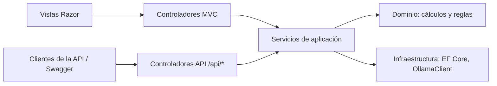

# ADR-004 — Arquitectura del monolito modular y entorno de ejecución

| Campo | Valor |
|---|---|
| Estado | **Aprobado** |
| Versión | v1.0 |
| Fecha | 2026-11-10 |
| Aprobado por | Piero Carbajal |
| Fecha de aprobación | 2026-11-10 |
| PR de aprobación | PR que fusiona el Spec Pack v1.0 en `main` (ADR-005 §1) |
| Principios afectados | PRINCIPIO-002, PRINCIPIO-004, PRINCIPIO-007, PRINCIPIO-008, PRINCIPIO-011, PRINCIPIO-012 |
| Relacionado con | RN-101, RN-102, RN-137, RN-164, RN-169, RN-170, RN-177 · DEC-58, DEC-60, DEC-88 · `07-architecture.md` §2 y §4 |

## Contexto

PRINCIPIO-002 exige ASP.NET Core MVC con Razor **y** una API REST, organizados como monolito modular, pero ningún documento decía cómo se relacionan las vistas con la API ni qué módulos existen. Si las vistas y la API tuvieran lógica propia, cada regla de validación, aislamiento y antiforgery habría que implementarla y probarla dos veces.

Además, el equipo de desarrollo tiene 8 GB de RAM sin GPU: ejecutar Docker, SQL Server y Ollama a la vez deja poca memoria para el modelo.

El contrato de la API debe fijar, además, si el endpoint del token antiforgery exige sesión, qué se responde cuando falta `type`, el orden entre `404` y la validación del cuerpo, y cómo se aplica el antiforgery a los controladores.

## Decisión

### 1. Flujo de las solicitudes

- Las vistas Razor envían formularios a **controladores MVC**. No consumen la API con `fetch`.
- Los **controladores de la API REST** (`/api/*`) llaman a los **mismos servicios de aplicación**.
- **Toda** la lógica de negocio, validación de reglas, filtrado por `UserId` y cálculo vive en los servicios de aplicación y en el dominio. Los controladores solo traducen la solicitud HTTP y la respuesta.
- El módulo `Accounts` usa **controladores y vistas MVC propios** para el registro, el inicio y el cierre de sesión, sobre `UserManager` y `SignInManager`. No se usa `Microsoft.AspNetCore.Identity.UI` (ADR-001, RN-145).
- El resumen de IA se pide desde el dashboard con `POST /insights/monthly-summary` (controlador MVC). Ese controlador responde `303 See Other` hacia `/dashboard` y entrega el resultado (resumen, MSG-23 o MSG-24) por TempData, con el proveedor de cookie cifrado con Data Protection. El resumen no se guarda en la base de datos (RN-165).
- **Antiforgery:** se registra el filtro global `AutoValidateAntiforgeryTokenAttribute` en MVC, que valida `POST`, `PUT` y `DELETE` en los controladores MVC y API, con `HeaderName = "X-CSRF-TOKEN"`. El middleware `UseAntiforgery()` no basta, porque no actúa sobre los controladores (RN-101). En MVC, el rechazo se muestra con la página `400` de MSG-46 (RN-170). `POST /account/logout` es `[AllowAnonymous]` y, sin sesión, redirige al inicio de sesión sin validar el token (RN-177).
- **Identity:** `AddIdentityCore<ApplicationUser>().AddSignInManager().AddEntityFrameworkStores<ExpenseFlowDbContext>()` con `AddAuthentication(IdentityConstants.ApplicationScheme).AddIdentityCookies()`. Para `/api/*`, `OnRedirectToLogin` responde `401` con el `ProblemDetails` estándar (RN-102, DEC-88).
- **Validación en la API:** `ApiBehaviorOptions.SuppressModelStateInvalidFilter = true`. El controlador comprueba primero la pertenencia del recurso y después devuelve el `400` de validación (sección 3.1, «Precedencia»).
- **Estrategia de pruebas:** las reglas se prueban una vez, a nivel de servicio (pruebas unitarias). Cada endpoint, MVC y API, tiene además al menos una prueba de integración de su camino feliz, de aislamiento (`404`), de autenticación (`401` o redirección) y de antiforgery (`400`).

### 2. Módulos

| Módulo | Responsabilidad | Funcionalidad |
|---|---|---|
| `Accounts` | Registro, inicio y cierre de sesión, política de contraseñas y sesión (Identity) | M1 |
| `Transactions` | Gastos, ingresos, lista de movimientos, validaciones de RN-051 a RN-061 y RN-104 a RN-117 | M2, M3 |
| `Budgets` | Presupuesto mensual y su cálculo | M4 |
| `Dashboard` | Saldos, porcentajes, avisos y últimos movimientos | M5 |
| `Insights` | Resumen de IA: `OllamaClient`, `FigureVerifier`, instrucciones del prompt, payload | M6 |
| `Shared` | `MoneyRounding`, `MoneyFormat`, `MoneyParser`, `TimeProvider` de Lima (`LimaClock`), `ICurrentUser`, mensajes de la UI (sección 10 de `03`); en `Infrastructure`: `ExpenseFlowDbContext`, migraciones y seed; en `Web`: layout, vista de error y filtros | Transversal |

Cada módulo tiene las carpetas y namespaces `Domain`, `Application`, `Infrastructure` y `Web` (controladores MVC y API, vistas, DTO), dentro de `src/ExpenseFlow/Modules/<Módulo>/`, y un `README.md` (PRINCIPIO-012). Los namespaces `ExpenseFlow.Modules.<Módulo>.Domain` y `.Application` forman la capa de lógica de negocio de PRINCIPIO-011; esto incluye `Shared`.

- La aplicación es **un solo proyecto** (`src/ExpenseFlow`); las fronteras entre módulos se verifican con pruebas de arquitectura sobre el código fuente.
- Las vistas viven en `Modules/<Módulo>/Web/Views/` y se registran con `RazorViewEngineOptions.ViewLocationFormats`.
- Las configuraciones de EF Core de cada entidad viven en el `Infrastructure` de su módulo; `ExpenseFlowDbContext` (en `Shared`) las aplica.

Un módulo solo usa otro a través de sus servicios de aplicación públicos, nunca accediendo directamente a sus entidades.

### 3. Contrato de la API REST del MVP

#### 3.1 Convenciones comunes

| Aspecto | Contrato |
|---|---|
| Formato | JSON con nombres de propiedad en `camelCase`. Fechas `yyyy-MM-dd` (ISO 8601). Importes como **número JSON** con hasta 2 decimales (RN-053); la API no formatea importes, eso lo hace la UI (RN-081). `createdAt` en UTC, ISO 8601 con sufijo `Z`. |
| Enumeraciones | Se envían como texto con su código en inglés: tipo `Expense` / `Income`; categoría `Food`, `Transport`, `Studies`, `Entertainment`, `Health`, `Other`; medio de pago `Cash`, `Yape`, `Plin`, `Card`, `Other`; origen `FamilySupport`, `Job`, `Internship`, `Freelance`, `Other`; estado del presupuesto `NotConfigured`, `Normal`, `Exceeded`; aviso `Threshold80`, `Threshold100`. Un código desconocido → `400` con MSG-27. |
| Errores de validación | `400 Bad Request` con `ValidationProblemDetails`: `title` = texto de MSG-44 y `errors` es un diccionario `{ "campo": ["texto MSG-NN"] }` con los textos de la sección 10 de `03` (RN-116). |
| Otros errores | El `400` con MSG-22 (presupuesto de otro mes), el `409` (MSG-21), el `500` (MSG-40) y el `503` (MSG-23, MSG-24) usan `ProblemDetails` con `title` igual al texto del mensaje y la propiedad `code` (MSG-NN). El `401`, el `404`, el `405` y el `400` por antiforgery devuelven el `ProblemDetails` estándar de ASP.NET Core, sin `code`: no tienen mensaje en la sección 10 porque la UI no los muestra como error de un campo. |
| Respuestas comunes | `401` sin sesión, con `ProblemDetails` (RN-102); `400` sin token antiforgery válido en `POST`/`PUT`/`DELETE` (RN-101); `404` si el recurso no existe **o** es de otro usuario (RN-008); `Cache-Control: no-store` en todas las respuestas (RN-140). |
| Precedencia | Se evalúan en este orden y se responde con el primero que falla: (1) sesión ⇒ `401`; (2) token antiforgery ⇒ `400`; (3) existencia y pertenencia del recurso ⇒ `404`; (4) validación del cuerpo, incluido `type` distinto en un `PUT` (MSG-30) ⇒ `400`; (5) conflicto ⇒ `409`. Así, un `PUT` con `type` distinto sobre un recurso ajeno responde `404`, no revela que el recurso existe (DEC-58). |
| Token antiforgery | `GET /api/antiforgery/token` **no exige sesión** (`[AllowAnonymous]`). El token queda ligado a la identidad con la que se pide: el cliente lo pide **después** de iniciar sesión, y uno obtenido antes deja de ser válido (RN-101, DEC-60). |
| Propiedades no previstas | Se ignoran, incluida `userId` (RN-103). Única excepción: `type` en un `PUT` con un valor distinto del actual → `400` con MSG-30 (RN-112). |
| Errores de formato | Fecha que no sigue `yyyy-MM-dd` → MSG-28. Campo que no corresponde al tipo de movimiento (por ejemplo, `category` en un ingreso) → MSG-26. Valor de enumeración desconocido → MSG-27. `type` ausente en `POST /api/transactions` → MSG-43. `page` no entero o menor que 1 → MSG-29. Todos con `400`. |
| Cuerpo inválido | Cuerpo ausente o JSON mal formado → `400` con MSG-38, bajo la clave `$`. `amount` que no es un número JSON, o que no se puede representar como `decimal` → `400` con MSG-39, bajo la clave `amount`. |

#### 3.2 Endpoints

| Método y ruta | Entrada | Éxito | Errores propios | Reglas |
|---|---|---|---|---|
| `GET /api/transactions?page=n` | `page` entero ≥ 1 (por defecto 1) | `200` `{ items: [TransactionDto], page, pageSize: 20, totalCount }`. Una página posterior a la última devuelve `items: []` | `400` con MSG-29 si `page` < 1 o no es entero | RN-007, RN-079, RN-117 |
| `GET /api/transactions/{id}` | — | `200` `TransactionDto` | `404` | RN-008 |
| `POST /api/transactions` | `{ type, amount, date, category?, paymentMethod?, source?, sourceDescription? }`. `type` obligatorio (MSG-43). Gasto: `category` y `paymentMethod` obligatorios; `source` y `sourceDescription` prohibidos. Ingreso: `source` obligatorio, `sourceDescription` solo con `Other`; `category` y `paymentMethod` prohibidos (un campo prohibido → MSG-26) | `201` `TransactionDto` con cabecera `Location` | `400` | RN-051 a RN-061, RN-103, RN-105 a RN-110 |
| `PUT /api/transactions/{id}` | Los mismos campos que `POST`, **sin** `type`. `PUT` **reemplaza** el movimiento completo: todo campo obligatorio de su tipo debe enviarse, y si falta se responde con el mismo mensaje que en `POST` (MSG-11 a MSG-14, MSG-16). Un ingreso que pasa de `Other` a otro origen se envía sin `sourceDescription`; si lo incluye → MSG-26. Si el cuerpo incluye `type` distinto del actual → `400` con MSG-30, después de verificar la pertenencia | `200` `TransactionDto` | `400`, `404` | RN-008, RN-110 a RN-113, RN-160 |
| `DELETE /api/transactions/{id}` | — | `204 No Content` | `404` | RN-008, RN-115 |
| `GET /api/budgets/current` | — | `200` `BudgetDto`; si no hay presupuesto para el mes en curso, `204 No Content` (nunca `404`, que significa «recurso ajeno») | — | RN-022, RN-068 |
| `POST /api/budgets` | `{ amount }`. El mes es siempre el mes en curso (RN-022); no se acepta mes en el cuerpo | `201` `BudgetDto` con `Location` | `400` (MSG-09, MSG-19, MSG-20, MSG-25, MSG-39); `409 Conflict` (MSG-21) | RN-053, RN-062 a RN-064, RN-118, RN-139 |
| `PUT /api/budgets/{id}` | `{ amount }` | `200` `BudgetDto` | `400` (validación, o MSG-22 si el presupuesto no es del mes en curso); `404` | RN-008, RN-065, RN-118 |
| `DELETE /api/budgets/{id}` | — | — | `405 Method Not Allowed`: la ruta existe para `PUT` y no admite `DELETE` | RN-119 |
| `GET /api/dashboard` | — | `200` `DashboardDto` | — | RN-028 a RN-033, RN-066 a RN-081, RN-120 a RN-127, RN-162, RN-163 |
| `POST /api/insights/monthly-summary` | Sin cuerpo: siempre el mes en curso | `200` `{ month, text }` | `503` con `code` = `MSG-24` si la IA está deshabilitada (RN-132); `503` con `code` = `MSG-23` si la solicitud a Ollama falla, agota el tiempo o devuelve un texto con cifras no válidas (RN-038, RN-082, RN-166) | RN-034 a RN-043, RN-082 a RN-088, RN-128 a RN-134, RN-166 |
| `GET /api/antiforgery/token` | No exige sesión | `200` `{ token, headerName: "X-CSRF-TOKEN" }` | — | RN-101 |

Cualquier endpoint nuevo requiere actualizar esta sección.

#### 3.3 Objetos de respuesta

| Objeto | Propiedades |
|---|---|
| `TransactionDto` | `id`, `type`, `amount`, `date`, `category` (`null` en ingresos), `paymentMethod` (`null` en ingresos), `source` (`null` en gastos), `sourceDescription` (`null` salvo origen `Other` con descripción), `createdAt` (UTC, ISO 8601) |
| `BudgetDto` | `id`, `year`, `month`, `amount` |
| `DashboardDto` | `month` (`yyyy-MM`), `totalIncome`, `totalExpenses`, `monthlyBalance`, `cumulativeBalance`, `budget` (`null` sin presupuesto), `consumedPercentage` (`null` sin presupuesto), `remainingBudget` (mínimo 0.00; `null` sin presupuesto), `overspentAmount` (`null` si no hay exceso), `budgetStatus`, `alert` (`null`, `Threshold80` o `Threshold100`), `totalsByCategory` (lista `{ category, amount }` ordenada según RN-033, solo importes > 0; vacía si no hay gastos), `recentTransactions` (hasta 5 `TransactionDto`, RN-078 y RN-079; vacía si no hay movimientos) |

> Las vistas MVC muestran los mismos datos que estos objetos, formateados según RN-081 y RN-123 a RN-125. Las listas vacías se presentan en la UI con MSG-41 y MSG-42 (RN-162, RN-163).

### 4. Entornos de ejecución

| Entorno | Dónde corre la aplicación | SQL Server Express | Ollama | HTTPS / HSTS | Swagger UI |
|---|---|---|---|---|---|
| `Development` | Equipo de desarrollo, `dotnet run` | **Nativo** en el equipo | **Nativo**, en `localhost:11434` | Certificado de desarrollo de .NET / sin HSTS | Sí |
| `Testing` | GitHub Actions (`ubuntu-latest`) | Contenedor Docker (ADR-001) | **No**: respuestas simuladas | Sí / Sí | No |
| `Demo` | Equipo de desarrollo, `dotnet run` | Nativo | Nativo, en `localhost` | Certificado de `mkcert` / Sí | No |

- En el equipo de desarrollo no se usa Docker. Eso libera ~2 GB de RAM para el modelo (ADR-003).
- En `Demo`, la aplicación escucha en la IP de la red local para la prueba T4 desde Android. SQL Server y Ollama siguen escuchando **solo en `localhost`**.
- En todos los entornos, Kestrel acepta solo TLS 1.2 y TLS 1.3 (`SslProtocols = SslProtocols.Tls12 | SslProtocols.Tls13`, RN-156).
- HSTS se configura con `HstsOptions.ExcludedHosts` vacío, para que la cabecera también se envíe a `localhost` en `Testing` (RN-100).
- Cadena de conexión: user-secrets en `Development`; variable de entorno `ConnectionStrings__Default` en `Demo` y `Testing` (PRINCIPIO-008).
- **Supuesto:** el equipo de desarrollo es un PC x64 con Windows o Linux. Un equipo ARM (Mac con chip Apple o Windows ARM) requiere revisar este ADR.

#### 4.1 Pruebas E2E en el CI

- Las pruebas E2E levantan la aplicación dentro del proceso de pruebas con `WebApplicationFactory` sobre Kestrel (`UseKestrel()`, disponible en .NET 10), en el entorno `Testing` y con HTTPS en un puerto local.
- El cliente de IA (`IOllamaClient`) se reemplaza con `ConfigureTestServices` por una implementación simulada que devuelve los casos de éxito, fallo y cifra no válida. No se usa un servidor HTTP falso ni un paquete nuevo.
- El certificado se genera en el job con `dotnet dev-certs https`. El contexto de Playwright usa `IgnoreHTTPSErrors = true`, solo en las pruebas.
- Las pruebas que verifican reglas llevan `[Trait("Rule", "RN-NNN")]`, y un paso del CI comprueba la cobertura de las reglas de cálculo (ADR-001 §3).
- Las pruebas E2E son condición bloqueante del CI (PRINCIPIO-011, ADR-001 §3).

#### 4.2 Migraciones

- La aplicación **no** aplica migraciones al arrancar: se prohíbe `Database.Migrate()` en el código de producción.
- En `Development` y `Demo`, un humano ejecuta `dotnet ef database update` (herramienta local de ADR-001).
- En `Testing`, un paso del CI ejecuta `dotnet ef database update` contra el contenedor, antes del seed y de las pruebas.

### 5. Fecha y hora del sistema

- Todo el código obtiene la fecha y hora actual mediante `TimeProvider` (incluido en .NET), inyectado como dependencia. Se prohíben `DateTime.Now`, `DateTime.UtcNow`, `DateTime.Today`, `DateTimeOffset.Now` y `DateTimeOffset.UtcNow` fuera del registro de `TimeProvider` (RN-137).
- Las columnas de fecha no tienen valores por defecto calculados en SQL Server (`GETDATE()`, `GETUTCDATE()`, `SYSDATETIME()`): la aplicación asigna el valor.
- Identity se registra con el mismo `TimeProvider`, para que el bloqueo de cuenta (RN-048) se pueda probar con `FakeTimeProvider`.
- La zona horaria `America/Lima` se resuelve en un único servicio (`LimaClock` en `Shared`).
- Las pruebas usan `FakeTimeProvider` (ADR-001) para fijar «hoy».
- La verificación es una prueba de arquitectura que analiza el código fuente (`.cs` y migraciones), porque la reflexión no detecta llamadas dentro de los métodos.

### 6. Globalización

- `InvariantGlobalization` está **desactivado** (`false`) en todos los proyectos, para que `es-PE` y `America/Lima` estén disponibles.
- El CI incluye una prueba que verifica que `CultureInfo.GetCultureInfo("es-PE")` y `TimeZoneInfo.FindSystemTimeZoneById("America/Lima")` funcionan y que `MoneyFormat.Format(1250.5m)` devuelve exactamente «S/ 1,250.50». Si la prueba falla en un entorno, ese entorno no es válido.

### 7. Errores no controlados

- Vistas MVC: `UseExceptionHandler("/Error")` con una vista en español que muestra MSG-40 y responde `500`. Los `404` de MVC muestran la página de MSG-45 (RN-169).
- API: `500` con `ProblemDetails` (`title` = texto de MSG-40, `code` = `MSG-40`).
- Fuera de `Development` no se muestran trazas ni detalles técnicos (RN-164). En `Development` se permite la página de excepciones para desarrolladores. El detalle técnico va solo al log, respetando RN-006 y RN-133.

## Alternativas descartadas

- **Vistas que consumen la API con `fetch`:** exigiría JavaScript para todo (contra ADR-006) y duplicaría el manejo de errores en el cliente.
- **Un proyecto por módulo:** más complejidad de compilación sin ventaja para un equipo de una persona; las fronteras se verifican con pruebas de arquitectura.
- **Docker en el equipo de desarrollo:** consume ~2 GB de los 8 GB que necesita el modelo.

## Consecuencias

- **Positivas:** una sola implementación de cada regla; pruebas sin duplicar; entorno local viable con 8 GB; pruebas de fecha deterministas; las pruebas E2E no necesitan Ollama ni paquetes nuevos; la base de datos nunca cambia de esquema por arrancar la aplicación; la precedencia de errores no revela la existencia de recursos ajenos; el antiforgery cubre MVC y API con un solo filtro.
- **Negativas:** el entorno de desarrollo depende de instalar SQL Server Express y Ollama a mano. El README raíz documenta la instalación. Aplicar las migraciones es un paso manual en `Development` y `Demo`. Desactivar el filtro automático de `ModelState` obliga a cada controlador API a devolver el `400` de validación de forma explícita, después de la comprobación de pertenencia.
